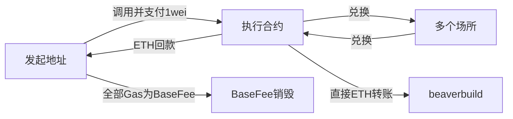
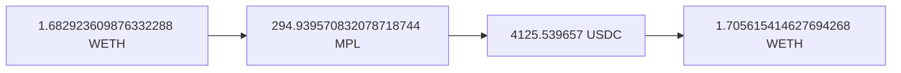
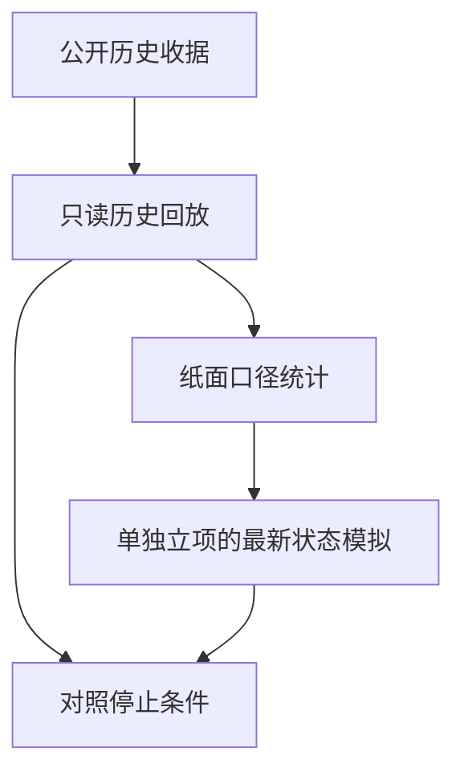

# 以太坊区块 21960556：同链单笔原子多池循环

- 归档日期：2026-11-20 Asia/Shanghai
- 链：Ethereum mainnet，chain id 1
- 策略类型：同链、单笔、原子、多池循环套利
- 案例时间：2025-03-02 17:02:47 UTC，即 2025-03-03 01:02:47 Asia/Shanghai
- 研究状态：历史执行和一条计价循环已按公开页面复核。44 个场所、24 种币和原帖 1.58 万美元估值仍是第三方统计。没有 2026 年池状态模拟
- 证据等级：A 为页面原始字段，B 为由 A 做的精确算术，C 为第三方叙述，D 为未访问，E 为假设示例
- 来源与边界：[sources.md](sources.md)
- 归档规则：[docs/arbitrage-archive.md](../../../../docs/arbitrage-archive.md)

本文件是一次人工复核后写下的研究笔记。它不监控新区块，也不会在以后自动补充交易或改写结论。笔记里的验证步骤都是只读研究；本次没有签名、广播或提交任何交易。

## 结论

这笔交易已经在以太坊主网区块 21960556 成功执行。公开转账能够支持“同一笔交易里完成多池兑换，并用 ETH 同时向 beaverbuild 转账和向发起地址回款”这一历史事实。发起地址在计入 gas 和 1 wei value 之后，ETH 数量增加 0.620999560467338341。按浏览器交易页上的历史汇率字段 2,518.51 美元/ETH，该数量对应 1,563.99360303259628519191 美元。

这条记录适合作为专业 MEV 系统的历史样本：它展示了原子执行、构建者竞价和 gas 销毁如何同时进入一笔交易。它没有提供可重复的胜率，也没有覆盖研发、节点和其他尝试的成本，因此不能把它写成普通人可以照搬的稳定收益项目。归档日没有做池状态模拟，本笔记不说明 2026-11-20 是否仍存在同类价差。

## 策略类型

这是以太坊单链上的一笔成功交易。多个兑换、构建者转账和发起地址回款出现在同一个交易收据里；交易成功时，这些状态变化一起提交。

本案例的类型边界：

| 边界 | 本笔观察 |
| --- | --- |
| 链 | 仅 Ethereum mainnet |
| 笔数 | 一个交易哈希 |
| 原子性 | 成功执行后，收据内的状态变化属于同一笔交易 |
| 场所 | 同一笔内出现多个自动做市商和流动性场所标签 |
| 结算资产 | 发起地址最终观察到 ETH 回款；中间路径使用 WETH 及其他代币 |

本案例不是跨链桥搬运，不是中心化交易所之间的搬砖，也不是由人工在多笔市场订单之间持仓。原帖点名的场所全部属于其叙述；本笔记只把页面上实际出现的标签算作已看见的场所。

## 时间、链与区块

Etherscan 与 Blockscout 对下表的原始字段一致。时间换算使用固定的 Asia/Shanghai 偏移 UTC+8，没有夏令时。

| 项目 | 内容 | 等级 |
| --- | --- | --- |
| 链 | Ethereum mainnet | A |
| 交易 | `0xcfb8d71e8e73f96c4ea215bd3a5305b4b4d93fc92e340a914e51b2aab70a5911` | A |
| 状态 | Success / success | A |
| 区块 | 21960556 | A |
| UTC | 2025-03-02 17:02:47 | A |
| Asia/Shanghai | 2025-03-03 01:02:47 | B，由 UTC 加 8 小时 |
| 区块内位置 | 1，从 0 起算 | A，Blockscout `position` |
| 交易类型 | EIP-1559，type 2 | A |
| Nonce | 55253 | A |
| From | `0x2Ee36E41387f87B7e6f678A86D1e575b23b996F5` | A |
| To | `0xe6b1DE575e7e610889ea21024834e120f92033a3` | A |
| Value | 1 wei | A |
| Gas limit | 7,140,000 | A |
| Gas used | 4,759,691（占 limit 的 66.66%） | A |
| Gas price | 46.634190131 Gwei，即 46,634,190,131 wei | A |
| Base fee | 与 gas price 相同 | A |
| Max fee | 与 gas price 相同 | A |
| Max priority fee / priority fee | 0 | A |
| 交易费 | 0.221964335058809521 ETH | A |
| 其中烧毁 | 与交易费相同 | A |
| Ether Price / historic exchange rate | 2,518.51 美元/ETH | A，两个页面的历史字段同值 |
| Logs | Etherscan 显示 242 | A |
| ERC-20 转账条数 | Etherscan 显示 131 | A，这是转账条数，不是币种数 |

Gas 复核：

```text
4,759,691 × 46,634,190,131 = 221,964,335,058,809,521 wei
                       = 0.221964335058809521 ETH
```

此前底稿写“约 476 万 gas，未复核则不要写精确值”。本次两个公开来源都给出 4,759,691，因此精确值可以进入报告。

## 参与地址

| 角色 | 地址或标签 | 观察 |
| --- | --- | --- |
| 发起地址 | `0x2Ee36E41387f87B7e6f678A86D1e575b23b996F5` | EOA。支付 1 wei value 和全部 gas，并收到合约回款 |
| 执行合约 | `0xe6b1DE575e7e610889ea21024834e120f92033a3` | Blockscout 显示合约、源码未验证。OLI 标签名称为 Beanstalk3。标签只说明第三方名录这样称呼它 |
| 构建者收款地址 | `0x95222290DD7278Aa3Ddd389Cc1E1d165CC4BAfe5` | Etherscan 内部交易把收款方标为 beaverbuild |
| 本条循环的场所标签 | Uniswap V3: MPL 2；Balancer: MPL/USDC 50/50；Uniswap V3: USDC 3 | 名称来自 Etherscan 转账行 |

Nonce 55253 只说明该 EOA 在此之前已经发出过这么多交易。本笔记没有检查那些交易的盈亏。

## 逐步机制

### 整笔交易在做什么

发起地址调用执行合约。合约在同一笔交易中与多个场所交换资产，然后从合约地址转出两笔 ETH：一笔到 beaverbuild，一笔回到发起地址。优先费为 0，所以发起地址支付的 gas 全部是 base fee，进入销毁，不进入 beaverbuild 的这笔直接转账。

可以把整笔交易看成三层：

1. 场所层：多条兑换改变合约持有的代币数量。自动做市商收费和价格冲击已经包含在换入、换出的数量里。
2. 竞价层：合约向构建者地址直接转 ETH。这个金额是该笔竞价的结果，协议没有规定它必须等于某个百分比。
3. 结算层：剩余 ETH 回到发起地址。发起地址另外支付 gas 和 1 wei value。



上图是这笔已上链交易的资金分层，不是一个正在运行的系统。

### 一条已经对上数量的循环

Etherscan 的 ERC-20 行给出下面三个数量。经济闭环按计价币 WETH 来写：

1. 合约向标签为 Uniswap V3: MPL 2 的池支付 1.682923609876332288 WETH，并收到 294.939570832078718744 MPL。
2. 合约把这 294.939570832078718744 MPL 交给标签为 Balancer: MPL/USDC 50/50 的池，并收到 4125.539657 USDC。
3. 合约把这 4125.539657 USDC 交给标签为 Uniswap V3: USDC 3 的池，并收到 1.705615414627694268 WETH。

全精度差额：

```text
1.705615414627694268 - 1.682923609876332288
= 0.022691804751361980 WETH
```

这条循环的手续费和滑点都已经体现在三个成交数量中。0.022691804751361980 WETH 是成交后的差额，不再额外扣除一次 AMM 费率。

它只是整笔交易中的一条小循环。0.022691804751361980 WETH 远远小于合约转出的 ETH，不能把它当成支付构建者的资金来源，也还没有分摊整笔 gas 和构建者转账。

### 页面行序和经济顺序不同

Etherscan 动作列表对这三笔的展示顺序是：先 MPL 换 USDC，再 USDC 换 ETH，再 ETH 换 MPL。ERC-20 行也先出现“从 Uniswap V3 MPL 池收到 MPL”，后出现“向该池支付 WETH”。

这个展示顺序和“先取得中间代币、再结算支付”相容。本次没有解码完整调用栈，所以报告只确认两种事实：经济闭环可以用上面三个数量闭合；页面行序不是该闭环的叙述顺序。调用栈级的先后仍然是未解问题。



图中箭头是计价闭环。它不表示 Etherscan 动作列表的从上到下顺序。

### 原子成功和两种失败的差别

本笔状态是成功，因此不存在半程持仓：收据里的兑换和两笔 ETH 转出一起生效。

研究同类机制时要分开两种没有成功的结局：

- 交易已经进入区块但执行回滚。状态变化会撤销，已上链的 gas 仍由发送者承担。
- 私有 bundle 没有被纳入区块。Flashbots 的故障排查文档说明，这种路径通常不会在链上留下失败交易，因而通常没有链上 gas。文档同时列出激励不足、竞争报价更高、送达过晚、验证者未连接相应中继等原因。私有提交本身不保证会被纳入，也不保证其他搜索者看不见或追不上同一机会。

这两段是机制说明。本笔记没有发现本笔的失败副本，也不把本笔鉴定为 Flashbots bundle。能够确认的是：它由 beaverbuild 标签地址收到直接 ETH 转账，优先费为 0，并且位于区块位置 1。

## 真实案例

### 原帖说了什么

EigenPhi 帖文在公开转载接口中的正文是：44 个交易场所、24 种代币；涉及 Curve、MakerDAO、Balancer、Uniswap V2/V3/V4、Bitcoin.com Verse、Pancake 和 Fluid；收入 1.58 万美元；向 beaverbuild 支付 5.6 ETH；留下约 1,500 美元。帖文时间是 2025-03-03 17:00:40 UTC，晚于本笔区块时间。x.com 页面本次返回 403，短链返回 404，配图没有识别。44、24 和两个美元整数都保持 C 级。

### 页面实际显示的范围

Etherscan 概览标题写着 “Aggregated Swap of 14 Tokens” 和 “on 3 Platforms”，并带有 “+10” 标记；动作区还提示列表可以继续展开。因此 14 和 3 是浏览器摘要，不是完成的普查。

本次取回文本里能够看到的场所标签包括 Uniswap V2、Uniswap V3、Uniswap V4、Balancer、Curve、Fluid，以及 MakerDAO 的 sDAI 标签。Verse 和 Pancake 的名字没有出现在这次文本检索中。转账列表同时出现 WBTC、WETH、UNI、MPL、USDC、USDT、USDe、DAI、DOGE、XYO、cvxCRV、CRV、REQ、ONDO、sUSDe、scrvUSD、crvUSD、FRAX、sDAI 等标签。页面声明列表不完整，Blockscout 的代币转账也因为 overflow 只返回 10 条，所以这里不给出另一个“独立币种总数”。

已闭合的只有上一节的 WETH → MPL → USDC → WETH。其余动作行说明整笔交易比这一条循环大，但每一条都还没有按同样的标准结平。

### 两笔决定性的 ETH 转账

Etherscan 内部交易显示，执行合约转出：

| 方向 | 全精度 ETH | 等级 |
| --- | --- | --- |
| 合约 → beaverbuild | 5.589480785977019676 | A |
| 合约 → 发起地址 | 转账行 0.842963895526147863；同一页净转账行写成 0.842963895526147862 | A，两行相差 1 wei |

净转账行比转账行少 1 wei，交易 value 也是 1 wei。本次没有状态差分，不能证明前者已经把这 1 wei 算进去，所以两行都保留。下面的净额采用较大的转账行，再减去 gas 和 1 wei。

## 收益分层

### 三条不能混用的口径

| 层 | 定义 | 本笔数字 | 等级 | 还没有包含 |
| --- | --- | --- | --- | --- |
| 单循环毛差额 | 一条 WETH 循环的成交后差额 | 0.022691804751361980 WETH | B | 其他路径、构建者转账、gas、1 wei、期间成本 |
| 合约两笔 ETH 转出之和 | beaverbuild 转账加发起地址回款 | 6.432444681503167539 ETH | B | 期初库存证明。若合约用原有 ETH 支付，这个和就不是池子新产生的毛利 |
| 发起地址 ETH 净增加 | 回款 − gas − value | 0.620999560467338341 ETH | B | 其他交易、研发、节点、失败尝试、组织成本 |
| 经营收益 | 上一项减去全部期间成本 | 未编制 | D | 缺少成本材料，不能用 0 代替 |

发起地址净增加的计算：

```text
0.842963895526147863
- 0.221964335058809521
- 0.000000000000000001
= 0.620999560467338341 ETH
```

若只使用两个六位四舍五入输入：

```text
0.842964 - 0.221964 = 0.621000 ETH
```

0.621000 ETH 是六位展示口径的精确差。全精度口径比它少 0.000000439532661659 ETH。此前“净增加 0.621 ETH”指的是前者。

### 成本加总不是构建者收入

| 项目 | ETH | 接收方或去向 | 等级 |
| --- | --- | --- | --- |
| 构建者直接转账 | 5.589480785977019676 | beaverbuild 标签地址 | A |
| Base fee | 0.221964335058809521 | 销毁 | A |
| 优先费 | 0 | 无 | A |
| 二者加总 | 5.811445121035829197 | 没有单一接收方 | B |

旧底稿用 5.58948 + 0.221964 = 5.811444。这是“五位构建者金额加六位 gas”的精确加法。全精度和比它多 0.000001121035829197 ETH，六位四舍五入后是 5.811445 ETH。报告此后使用全精度和，并把旧加法留在复核记录里。

构建者实际收到的是第一行。Gas 是发起地址支付并烧毁的 base fee。

### 美元标注

历史汇率只使用两个浏览器共同给出的 2,518.51 美元/ETH。它是交易页的历史字段，不是本次重建的 17:02:47 逐笔成交价。公开日线摘要里，同一 UTC 日还能看到 2,518.10、2,518.11 和 2,519.69 美元等收盘口径；它们只说明字段选择会改变美元列。

| 数量 | 乘以 2,518.51 的精确结果（美元） | 等级 |
| --- | --- | --- |
| 0.620999560467338341 ETH | 1,563.99360303259628519191 | B |
| 0.621000 ETH | 1,563.99471 | B |
| 5.589480785977019676 ETH | 14,077.16325429098382420276 | B |
| 0.221964335058809521 ETH | 559.01939748896236673371 | B |
| 5.811445121035829197 ETH | 14,636.18265177994619093647 | B |
| 6.432444681503167539 ETH | 16,200.17625481254247864689 | B |
| 0.022691804751361980 WETH | 57.14953718435266024980 | B，且只代表那一条循环 |

到美元整数时，0.621 ETH 对应约 1,564 美元，与旧底稿一致。到分时，全精度净额是 1,563.99 美元。原帖的 “$1.5K” 和这个区间同量级，两者的估值方法和时点没有复原，不能写成同一个数。

原帖的 1.58 万美元也没有复原。6.432444681503167539 ETH 乘以 2,518.51 得到 16,200.17625481254247864689 美元，和 15,800 美元并不相等。15,800 / 6.432444681503167539 约等于 2,456.30 美元/ETH，既不是 2,518.51，也不是下面记录的现价横幅。可能的原因包括对方使用了另一套收入定义或另一个价格，但本次没有证据选择其中任何一个。1.58 万美元继续作为 C 级叙述保留。

### 现价美元只用于识别错误口径

复核当时，Etherscan 页顶 ETH 价格横幅为 1,771.80 美元，beaverbuild 那一行旁边显示 9,903.44 美元。两者的关系是：

```text
5.589480785977019676 × 1,771.80 = 9,903.44205659408346193680
```

四舍五入到分就是页面上的 9,903.44 美元。Blockscout 同一次读取的 `exchange_rate` 是 1,773.59，和 Etherscan 横幅也不同。这些都是 2026-11-20 前后的页面现价字段。历史收入表不使用它们。

## 费用、单位与价格口径

| 口径 | 规则 |
| --- | --- |
| ETH / WETH | 页面显示到 1 wei 时保留 18 位小数。WETH 与 ETH 在数量表中分开命名；只有在讨论发起地址的 ETH 余额变化时才把回款、gas 和 value 放在同一条 ETH 等式里 |
| MPL | 使用 ERC-20 行 294.939570832078718744。六位四舍五入是 294.939571 |
| USDC | 使用 ERC-20 行 4125.539657。页面没有给出更多小数 |
| Gas | 使用 wei 乘法，不把 4,759,691 再写成约数 |
| 构建者金额的旧五位写法 | 5.589480785977019676 保留五位是 5.58948，因为下一位是 0。保留六位则四舍五入为 5.589481 |
| 回款的旧六位写法 | 0.842963895526147863 四舍五入到六位是 0.842964 |
| 循环差额的两种六位结果 | 先把两条 WETH 分别四舍五入到六位再相减：1.705615 − 1.682924 = 0.022691。先用全精度相减再四舍五入到六位：0.022692。主数字是全精度差 0.022691804751361980。旧口述 0.022692 来自第二种顺序 |
| 历史美元 | 只乘 2,518.51，并同时保留 ETH 原值 |
| 现价美元 | 单独记录，不与历史收入相加或替换 |

价格每变化一个字段，美元就换一行。例如全精度净额在 2,518.10 美元/ETH下是 1,563.73899321280467647210 美元，在 2,519.69 美元/ETH下是 1,564.72638251394774443429 美元。这是同一 ETH 数量的字段敏感性，不是价格预测。

## 符号关系与假设示例

设本笔能够观察的数量为：

```text
R = 0.842963895526147863 ETH
F_base = 0.221964335058809521 ETH
F_tip = 0
V = 1 wei
B = 5.589480785977019676 ETH
G_cycle = 0.022691804751361980 WETH
P = 选用的美元价格
```

```text
发起地址 ETH 净增加 = R - F_base - F_tip - V
美元标注 = (R - F_base - F_tip - V) × P
成本加总 = B + F_base + F_tip
两笔转出之和 = B + R
```

`G_cycle` 不能代入上面三条 ETH 等式。它没有覆盖其他路径，也没有分摊 `B` 和 `F_base`。

对任意价格字段，净额美元对价格的敏感度就是净额本身：

```text
d/dP [(R - F_base - F_tip - V) × P] = 0.620999560467338341 美元，每 1 美元/ETH
```

因此价格字段每相差 1 美元/ETH，美元标注就相差约 0.621 美元。这是换算敏感度。下面的 1% 只作为 E 级例示，不代表价格会这样变动：

```text
0.620999560467338341 × 2,518.51 × 1% = 15.6399360303259628519191 美元
```

例示的含义是：在这个历史净额上，价格字段相对 2,518.51 偏离 1%，美元标注大约变化 15.64 美元。它不是收益预测。

## 资金门槛

已观察的交易 value 是 1 wei。1 wei 是调用附带值，不是交易规模，也不能当成最低本金。

页面上能看到远大于回款的中间数量，例如单行内部转账中的数十到数百 ETH，以及数十万单位的稳定币标签。原子交易可以在同一笔内取得并归还流动性，所以中间名义金额不等于发起地址必须预先持有的本金。

本次没有证明：

- 合约在交易前的 ETH 或其他代币库存。
- 是否使用了闪电贷，以及如果使用，贷方是哪一个合约。
- 发起地址除 gas 和 1 wei 之外还冻结了多少资金。
- 为了研究和运行此类系统需要的设备、节点和人员支出。

资金门槛因此记为未知。不估计一个最低本金，也不把中间名义金额写成资本要求。

## 技术架构

下面列出的是理解并只读复核这类历史交易时要分开的组成部分。列出名称是为了安排后续研究，不是说本仓库已经拥有这些组件。

| 组成部分 | 在本笔中的研究含义 |
| --- | --- |
| 池状态 | 成交数量取决于交易进入时的池储备、价格区间和流动性。归档没有读取区块 21960555 的状态 |
| 多路径 | 收据表明一条交易里有多条兑换。只闭合了 MPL 这一条 |
| 规模 | 单循环差额只有约 0.0227 WETH，说明规模选择和路径选择会决定差额落在哪一条路径上。最优规模没有重算 |
| 共享池 | 同一池若在一笔内被使用多次，后一步看到的是前一步改变后的状态。未做逐步状态推演 |
| 流动性与滑点 | 已经包含在成交数量中。不能在差额之外再减一次名义费率 |
| Gas | 本笔是 4,759,691 gas，且全部按 base fee 销毁 |
| 构建者竞价 | 5.589480785977019676 ETH 是直接转账。竞价没有协议固定值，上链前其他竞价也不可见 |
| 模拟 | 研究时应先做只读模拟，再比较收据。本次没有运行模拟 |
| 私有提交与延迟 | 文档说明送达时间、验证者连接和竞争报价都会影响纳入。本笔的提交通道未鉴定 |
| 会计 | 毛差额、转出之和、地址净增加和经营收益必须分层 |

后续研究若继续，顺序固定为：

1. 只读历史回放：在父区块状态下重放这笔历史交易，比较代币和 ETH 差额。
2. 纸面统计：先写明样本是否包含未上链和失败上链，再统计。
3. 最新状态模拟：单独立项，只读取模拟时的状态，不签名、不广播。



这张图是以后由人执行研究时的顺序。本仓库没有按该图运行的作业，也不会把模拟结果自动写回报告。第 3 步在本案例中没有执行。

## 财务可行性

就这一笔历史样本而言，财务上能够说清楚的部分是链上现金分拆：

- 合约转给 beaverbuild 的 ETH，多于转回发起地址的 ETH。
- 发起地址在支付 gas 和 1 wei 后，ETH 数量仍然增加。
- 增加额的历史字段换算约为 1,564 美元。
- 一条已闭合循环只解释约 0.0227 WETH，解释不了整笔转出。
- 经营收益没有编制。

因此，本笔证明该次执行在发起地址的 ETH 数量上为正，同时把更大的一笔 ETH 付给了构建者。它没有证明这种结构在扣除全部尝试和运营成本后为正，也没有证明下一次仍会赢得出块位置。

财务可行性研究如果继续，只能先做纸面账：为毛收益、净收益和经营收益各选一个不可混用的定义，把失败上链的 gas 和未上链的次数分开计数，并在计算前固定价格字段。成功收据单独组成的样本会高估结果。本归档没有做这个样本，也不填写任何胜率或年化。

## 风险

| 风险 | 与本笔的关系 |
| --- | --- |
| 状态过期 | 多池路径依赖交易执行当时的储备。笔记没有重建该状态 |
| 共享池自影响 | 同一笔内的前后兑换会改变后续价格。未做逐步推演 |
| 滑点和 AMM 费被重复扣除 | 成交数量已经是净数量。再减一次名义费率会把差额算小 |
| 竞价高于价差 | 本笔构建者转账远大于单条 MPL 循环差额。竞价是结果，不是固定成本 |
| 延迟和未纳入 | 私有提交仍可能因为时间、中继或竞争而没有上链。未上链通常没有这笔链上 gas，但机会也没有实现 |
| 上链后回滚 | 状态会撤销，gas 仍可能支付。本笔没有回滚 |
| 私有通道的保证范围 | 私有提交不提供“一定纳入”或“没有竞争”的保证。本笔通道也未鉴定 |
| 幸存者偏差 | 公开讨论容易集中在成功收据上。失败和未纳入没有进入本笔记的分母 |
| 价格口径 | 2,518.51、日线收盘和 2026 年页面现价回答的是不同问题 |
| 汇总数字 | 44/24、14/3 和 131 条 ERC-20 转账分别是统计、页面摘要和转账条数 |
| 合约未验证 | 执行合约源码标记为未验证。OLI 名称不能代替源码或控制人 |
| 经营成本缺失 | 单笔 ETH 净增加会高于经营收益。缺口的大小未知 |
| 把历史样本当成当前机会 | 没有 2026-11-20 的池状态模拟，不能推断价差仍在 |

## 验证方案与停止条件

本次已经完成的检查：

1. 读取 Etherscan 交易页的状态、区块、时间、gas、费用、value、收发地址和关键转账。
2. 用 Blockscout 只读交易接口对照上述原始字段和历史汇率。
3. 用 wei 乘法重算 gas。
4. 用全精度和六位两种顺序重算回款、成本加总与 MPL 循环差额。
5. 用 1,771.80 识别转账旁边的美元来自现价横幅。
6. 读取原帖转载正文；x.com 直连失败则保持失败记录。
7. 读取 Flashbots 故障排查页，只提取私有 bundle 纳入失败的一般条件。

本次没有做、以后也只能作为只读研究来做的检查：

| 步骤 | 输入 | 对照 | 停止条件 |
| --- | --- | --- | --- |
| 历史回放 | 父区块的只读状态和这笔历史交易 | 收据中的状态差额、gas used 和两笔 ETH 转出 | 币种差额不一致，且调用栈不能解释 |
| 场所与币种普查 | 完整事件和调用，而不是截断的动作列表 | 原帖的 44 与 24 | 在列表仍被截断时写出新的总数 |
| 价格复原 | 原帖或数据商明确写出的时间和字段 | 2,518.51 与 1.58 万美元、1,500 美元 | 字段名缺失时把美元写入结论 |
| 纸面统计 | 预先登记的样本，包含失败上链和未上链 | 成功样本单独计算的结果 | 分母只剩成功交易 |
| 最新状态模拟 | 模拟当时的只读池状态 | 本笔记的历史数量 | 把模拟结果写成“现在仍可交易”，或产生签名与广播 |

任何一步只要被要求提交真实交易、加入付费凭证，或把本文件说成已经运行的机器人，就停止并只在复核记录中写明要求超出了研究范围。

## 来源

完整边界见 [sources.md](sources.md)。

| 来源 | 访问 | 用于 |
| --- | --- | --- |
| Etherscan 交易页 | 已取回 | 原始交易字段、转账数量、历史 Ether Price、现价横幅对照 |
| Blockscout 交易接口 | 已取回 | 交叉确认字段、历史汇率、OLI 标签和源码未验证 |
| EigenPhi 帖文转载 | 正文已取回；x.com 直连 403 | C 级的 44、24、1.58 万美元、5.6 ETH 和约 1,500 美元 |
| bit.ly/4ijw5OQ | 404 | 不使用 |
| Flashbots troubleshooting | 已取回 | 私有 bundle 未上链的一般机制 |
| 2025-03-02 日线公开摘要 | 检索到邻近收盘价 | 说明历史汇率字段之外还有别的日线口径 |

## 未解决问题

1. 44 个场所和 24 种币还没有逐一独立复点。
2. Etherscan 的 14 个代币、3 个平台摘要与原帖不一致，但两边都不是完整清单。
3. Verse 和 Pancake 只出现在原帖点名中，没有在本次页面文本里对上。
4. 1.58 万美元的价格时点和收入定义没有复原，也不能由 2,518.51 美元/ETH 推出。
5. 除 MPL 循环外，其他兑换还没有逐条闭合。
6. 页面行序与经济顺序的差异还没有用调用栈证明。
7. 合约期初库存未知，因此两笔 ETH 转出之和还不能称为已审计的池子毛利。
8. 闪电贷或任何其他资金来源都没有鉴定，资金门槛未知。
9. 本笔是否经过 Flashbots、其他中继或 builder 私有通道，没有证明。
10. 发起地址的其他成功、失败和未上链尝试没有统计。
11. 研发、节点和其他经营成本没有材料。
12. 没有 2026-11-20 的只读池状态模拟，不能讨论当前是否还有价差。
13. 原帖短链失效，配图没有纳入证据。

## 复核记录

| 日期（Asia/Shanghai） | 检查 | 改动 | 仍开放 |
| --- | --- | --- | --- |
| 2026-11-20 | 对照 Etherscan、Blockscout、原帖转载和 Flashbots 文档。重算 gas、净额、成本加总和单循环差额 | 首次归档。Gas 改为精确的 4,759,691。构建者转账、回款、gas 和循环差额改用页面全精度。补入 1 wei value、优先费 0 和 base fee 销毁。5.811444 ETH 保留为旧舍入口径，主结果改为 5.811445121035829197 ETH。0.022691 与 0.022692 同时保留并写明舍入顺序。美元主结果绑定 2,518.51，现价横幅单独隔离 | 见上一节。44/24、1.58 万美元、完整路径、资金来源、提交通道和经营成本都未关闭 |

## 事实更正摘要

相对归档前的口述底稿，本次只改那些已经由页面字段重新算出的数字。

| 底稿 | 本次主结果 | 原因 |
| --- | --- | --- |
| 约 476 万 gas，未复核 | 4,759,691 | 两个浏览器一致，且与交易费的 wei 乘法闭合 |
| 构建者 5.58948 ETH | 5.589480785977019676 ETH | 五位小数恰好等于全精度截断到五位 |
| Gas 0.221964 ETH | 0.221964335058809521 ETH | 六位四舍五入仍是 0.221964 |
| 回款 0.842964 ETH | 转账行 0.842963895526147863 ETH | 六位四舍五入仍是 0.842964；净转账行另有 1 wei 差异 |
| 未单列 value | 1 wei | 两个来源的 value 都是 1 |
| 净增加 0.621 ETH | 全精度 0.620999560467338341 ETH；六位口径仍是 0.621000 ETH | 两种口径都保留 |
| 构建者付款加 gas 5.811444 ETH | 全精度 5.811445121035829197 ETH | 旧数字是舍入输入的精确和。Gas 同时改为“销毁的 base fee”，不再并入构建者收入 |
| 循环差额约 0.022691 WETH，口述另有 0.022692 | 全精度 0.022691804751361980 WETH | 0.022691 是先舍入到六位再相减；0.022692 是先相减再舍入到六位 |
| MPL 294.939571 | 294.939570832078718744 | 六位四舍五入仍是 294.939571 |
| 约 1,564 美元 | 全精度净额对应 1,563.99360303259628519191 美元 | 到美元整数仍可称为约 1,564 美元。价格字段是 2,518.51 |
| 1.58 万美元 | 维持 C 级，不改写成某个 ETH 数量 | 用 2,518.51 乘两笔转出之和得到约 16,200.18 美元，对不上 15,800 |
