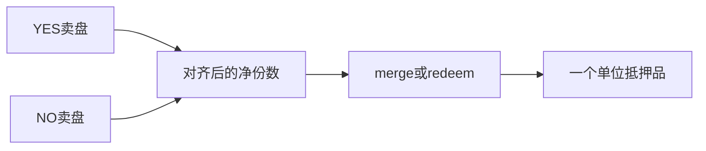
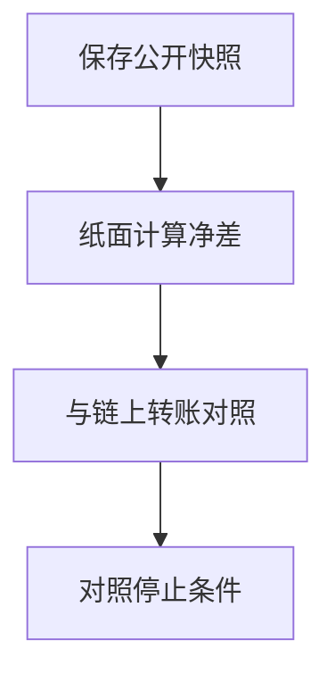

# Polymarket 完整集合：mo-money 收益故事

- 归档日期：2026-11-20 Asia/Shanghai
- 链：Polygon 上的 Polymarket 头寸。抽样交易在 Polygon，chain id 137。完整集合规则不表示每一笔都是同一个区块里的原子套利
- 策略类型：同一条件的 YES 与 NO 组成完整集合。毛价差不是净盈利的充分条件
- 案例时间：原帖 `2026-11-19T09:44:38.000Z`，即北京时间 2026-11-19 17:44:38。账户统计记录时点为北京时间 2026-11-20 02:00:01
- 研究状态：机制、当前费率公告和四笔链上样本已复核。平台累计盈亏没有审计成纯配对套利。视频没有给出可独立验证的完整账本。文末另有 CasaVerilla 提及的钱包 `0xfcda969d818f49fb945b889275405f929221eecc` 附录，不与本账户合并所有权或收益
- 证据等级：A 为本次重新打开的公开页面字段，B 为由这些字段做的精确算术，C 为帖文或未重拉的研究记录，D 为没有取得，E 为假设例子
- 来源：[sources.md](sources.md)
- 归档规则：[docs/arbitrage-archive.md](../../../../docs/arbitrage-archive.md)

本文件是人工研究笔记。它不监控新市场，也不会自动改写。笔记里的验证只描述只读和纸面步骤。本次没有连接钱包、签名或下单。

## 结论

同一条件、同一结算规则下，YES 与 NO 可以组成完整集合，合并或按规则赎回时回收一个单位抵押品。这个机制成立。YES+NO 小于 1 只说明存在毛价差，不能单独推出扣费后的净盈利。

公开账户 mo-money 存在，代理地址是 `0x32ed2e546b187ca15e2841edc82b22c713cf8ec3`。研究时点的平台统计有大额正的 `trade_pnl`，四笔重新打开的 Polygon 交易也显示该地址买卖互补结果并完成一次 merge。这些记录不能证明原帖的 560,370 美元全部来自“同时买入两边、合计低于 1 美元”，也不能证明每天让助手找机会就能复制。

按研究当时仍生效的 Crypto 吃单系数 0.07，假设两边都吃单、各 100 份、价格 48¢ 和 49¢，费用是 3.4965，毛差是 3，其他成本之前的净差是 −0.4965。若再假设当时的 Silver 8% 返佣全部合格到账，净差是 −0.21678。官方公告在北京时间 2026-11-21 07:59 把 BTC 5 分钟和 15 分钟市场的系数改为 0.05；同一组假设报价、不计返佣时净差变为 +0.5025。这是费制敏感性，不是当时或现在的可成交机会。

## 媒体证据

两段相关视频的复核只用下面这条保守结论，不用自动识别出的每一个标题或数字。

本帖视频主要展示自定义数据面板和交互界面。它没有提供足以独立复核双腿同时成交、真实成交价和全成本收益的完整记录。画面中有约 550,045.93 美元的累计收益展示，也有流动的单边成交。这个累计数与原帖的 560,370、研究时点平台 `trade_pnl` 的 601,539.115804 不同。时点和口径都可以不同，不能直接判定造假。

预览图含有截断地址，所以不能写成视频里绝无地址。能够写下的边界是：没有足够完整、可供独立验证的交易账本。

账户身份和四笔链上样本另有公开原始记录。视频材料的不足不把这些记录推翻成纯模拟或假账户。视频检查不能确认画面就是实盘账本，也不能确认造假。

## 策略类型

本案例讨论的是 Polymarket 二元市场上的完整集合：同一 `conditionId` 的两个互补结果，数量对齐后可以 merge，或者在结算后 redeem。

它不是跨链搬砖，也不是中心化交易所之间的人工搬运。两张独立订单簿订单也不自动构成一笔原子交易。链上某一笔撮合结算成功，只说明该笔订单的链上部分完成了。

账户里同时还能出现做市、库存、返佣、奖励和方向敞口。看见一次 merge，只证明当时把互补 token 交回并收到抵押品，不证明每一段库存都来自低于 1 的同时成交。

## 时间、链与范围

| 项目 | 内容 | 等级 |
| --- | --- | --- |
| 原帖时间 | 2026-11-19 09:44:38 UTC；北京时间 2026-11-19 17:44:38 | C，公开读取记录中的 `created_at`，不是由帖子编号推算 |
| 统计快照 | 北京时间 2026-11-20 02:00:01，timestamp 1795111201，source_block 97603821 | C，本次归档没有重拉该接口 |
| 链上抽样 | 北京时间 2026-11-20 02:15:04 至 02:18:46，Polygon | A，四笔交易页本次重新打开 |
| 费率切换 | 2026-11-20 23:59 UTC，即北京时间 2026-11-21 07:59 | A，公告页本次重新打开 |
| 代理地址 | `0x32ed2e546b187ca15e2841edc82b22c713cf8ec3` | C 为档案记录；A 为四笔交易里的同一地址 |
| 活动抽样范围 | 最新 20 项，`has_more=true` | C。不是全量历史 |

## 原帖主张

公开读取到的完整长文包含五组说法：累计 560,370 美元，并称只做公式套利；BTC 15 分钟涨跌例子为 YES 48¢、NO 49¢，合计 97¢，毛差 3¢；重复 107,973 次、累计交易量 2,880 万美元、单笔最高 2,719 美元；机器人搭好后几乎不用盯盘，开头还提到每天让助手找机会；手续费、滑点、深度和两边能否同时成交必须考虑，收益数据有待完整记录验证。

帖中的“钱包地址”打开后是 [带推荐参数的主页](https://polymarket.com/@mo-money?via=ace-cq9c)，不是裸地址。推荐参数应披露为潜在推广动机，但不能据此推断内容虚假。税务顾问对话没有税务记录、身份或访谈，不能核实成真实对话。

## 逐步机制

1. 只在同一个 `conditionId` 上读取两边的真实卖盘、数量、时间戳、市场版本、结算源和抵押品。不同到期时间、不同结算源或不同抵押品不能直接配成一套。
2. 按目标净份数 Q 逐档计算两边的成交价和费用。网页上的概率可以是中间价，价差很大时甚至可能显示末笔成交价，不能把网页标价直接相加。
3. 只有可执行净成本低于回收额、并且留有安全余量时，才把“取得相同净数量的互补 token”当成候选。
4. 两边都到手之后，按该市场所属的 CTF 或 Protocol V2，以及正确的抵押品路线 merge；结算后则按规则 redeem。旧样本回收的是 USDC.e，当前通用说明里常见 pUSD。两条路线都要单独对账。
5. 对账完成后再谈收益。多出来的一边仍是方向敞口。



上图是完整集合的经济顺序。它不表示两张订单会原子成交，也不是一个正在运行的程序。

两腿可以相隔数分钟，也可以一边先作为挂单成交。持有单边的期间有方向风险和时间风险，更接近带库存的做市。利润若主要来自返佣或奖励，应单列，不包进价差。

## 真实案例

### 账户与平台统计

研究记录中的公开搜索和档案把 mo-money、Amazing-Mail 与上述代理地址连在一起，并记录 takerTier=2、Silver、weightedVolume=173702.631924。档案创建时间记录为 `2025-08-07T17:56:13.986357Z`。真人身份没有验证。这些字段本次没有重拉，保持为该时点记录。

同一记录里的 v2 统计不能互相替代：

| 字段 | 记录值 | 边界 |
| --- | ---: | --- |
| `trades` | 114319 | 官方说明中的不同市场数量，不是成交笔数，也不是套利循环次数 |
| `trade_count` | 742441 | 成交 fills，不是配对数 |
| `volume` | 32601586.159361 | 份数口径，不能直接加美元符号 |
| `volume_usdc` | 16276407.904002 | 美元成交额，约 1,627.64 万，不是帖文的 2,880 万 |
| `trade_pnl` | 601539.115804 | 平台统计，不是审计后的外部现金净利润 |
| `position_pnl` | 539516.083634 | 另一口径，不能与 `trade_pnl` 相加 |
| `economic_pnl` | 616921.320634 | 又一口径，不能拿来替换帖文收入 |
| `maker_rebate` | 62248.5584 | 历史 maker 返佣不是零 |
| `taker_rebate` | 10411.0174 | 历史 taker 返佣不是零 |
| `reward_income` | 4745.6612 | 激励收入不是零 |
| `fees_paid` | −62023.03217 | 原返回带负号。不能把负号再减一次 |
| deposits、withdrawals、cashflow_net | null | 不能计算本金回报率，也不能把 null 当成 0 |

因此，大额正的平台盈亏和返佣有该时点的原始字段支持。560,370 美元是否为纯配对净利，没有证明。107,973 次可能混用了市场数、成交数或配对数；没有帖文当时的快照，不能确认，也不能断言它虚假。

### 四笔链上样本

最新 20 项活动不是全历史。下面四笔是本次重新打开的原始交易，市场标题为 Bitcoin Up or Down - November 19, 1:15PM-1:20PM ET。这是五分钟窗口，不是帖文里的 15 分钟、48¢ 对 49¢ 例子。

| 北京时间 | 本账户流量 | 角色与费用 | 交易 |
| --- | --- | --- | --- |
| 02:15:04 | 付出 240 pUSD，收到互补 token 500 份，单价 0.48 | OrderFilled 中 mo-money 为 maker，该事件 fee 为 0 | [C1](https://polygonscan.com/tx/0x58a0219048eba8e26446e34c705b4c30c6b26e519e656fba597d1819d2732c45) |
| 02:15:44 | 付出 5.7936 pUSD，收到同一互补 token 36.21 份，单价 0.16 | 可见转账等于这个名义价款。批次顶部是其他交易者 | [C2](https://polygonscan.com/tx/0xb71277a50268076697ef3516db8d7cc8231dccde243e738b8926044afc183ce0) |
| 02:18:22 | 收到 536.21 份 Up，付出 498.6753 pUSD，单价 0.93；另付费用 2.4435 pUSD | mo-money 为 taker。外层 gas 由另一个地址支付 | [C3](https://polygonscan.com/tx/0x07e8d427a187334bbf7f9186829f7409b684cd13b8e93eacb3674d0e2e67cdf8) |
| 02:18:46 | 销毁两种 token 各 536.21 份，收到 536.21 USDC.e | merge 回收的是 USDC.e，不是 pUSD | [C4](https://polygonscan.com/tx/0xe0b7953e1c2c0a107d91599f1d812e62910e99ea04ebc860cb52139f93d7d496) |

500 份与 36.21 份相加等于 536.21 份。若只把这三笔可见买入和随后的 merge 按 536.21 份脸面数量放在一起：

```text
240 + 5.7936 + 498.6753 = 744.4689 pUSD
536.21 USDC.e − 744.4689 = −208.2589
```

−208.2589 是脸面差额，而且两边还不是同一种记账资产。Up 这一腿另有 2.4435 pUSD 费用。这个组合只说明：可见流量不是“同时以 97¢ 买齐并锁定 3¢”。它不证明账户全程亏损，因为没有期初库存、其他转入转出和全部批次。C1 的 maker、fee 为 0，也说明不能把四笔都写成吃单。

按份数 536.21、价格 0.93、系数 0.07 计算的费用是 2.44350897。链上收费是 2.4435。文档写明费用保留到小数点后 5 位，那样会得到 2.44351，与链上的 2.4435 不完全相同。这笔费用和公式同量级，舍入规则还没有逐位复原。

## 收益分层

| 层 | 定义 | 本案例能写的数 | 等级 | 还没有包含 |
| --- | --- | --- | --- | --- |
| 毛价差 | 回收额减两边价款。AMM 或订单簿的成交价里已经包含滑点时，不再扣一次滑点 | 假设 100 对、48¢ 与 49¢：毛差 3 | E | 真实深度、未配对、费用 |
| 费用后的例子 | 毛差减两腿 taker 费用，可选地加一次合格返佣 | 当前 k=0.07：−0.4965；假设 8% 返佣：−0.21678；公告后的 BTC 短周期 k=0.05 且无返佣：+0.5025 | B，建立在 E 的报价上 | 滑点、gas、兑换、库存亏损 |
| 平台统计 | 接口返回的各 PnL 和返佣字段 | 见上表 | C | 不能相加，也不能当成外部现金净利 |
| 抽样脸面差额 | 三笔可见买入对一次 merge | −208.2589，且 pUSD 与 USDC.e 尚未换算 | B，单位混合 | 不是经营利润，也不是全程结果 |
| 经营收益 | 再减研究、失败尝试、资金占用和组织成本 | 未编制 | D | 没有这些材料 |

净损益的记账式是：

```text
净损益 = 合并或赎回收入
       + 已确认且未包含在收入口径里的返佣和奖励
       + 未配对库存的实际变现
       − 全部买入价款
       − 尚未包含在价款里的交易费
       − 自付的链上费用、兑换和转移成本
       − 其他直接成本
```

只做完整集合、并且价款 C 已经按实际深度包含滑点、费用 F 还没有包含在 C 里时：

```text
Π = Q − C_yes(Q) − C_no(Q) − F_yes − F_no − G − X + R − H
```

Q 是可合并的净份数，G 是自付链上与兑换成本，X 是其他直接成本，R 是已确认返佣或奖励，H 是计划阶段的资金占用或风险预算。实际会计结果和带 H 的经济结果要分开。已经记入的未配对平仓损失，不能再扣一次同一损失的预估数。C 若已是含费全包现金价，就不再减 F。真实 VWAP 不再另扣一次买卖价差或已经发生的滑点。返佣只计一次。平台 PnL 若已经包含返佣，就不能再把 `maker_rebate` 或 `taker_rebate` 加进去。

## 费用、单位与价格口径

当前官方公式，在 2026-11-20 23:59 UTC 之前有效：

```text
fee = shares × feeRate × p × (1 − p)
```

`feeRate` 是类别系数，不是成交额的固定百分比。本次打开的费用页上，Crypto 为 0.07，Weather 为 0.05，Geopolitics 为 0，Maker 的平台交易费为 0。费用保留到小数点后 5 位，最小收费 0.00001。

假设例子只使用两腿都吃单、Q=100、p 为 0.48 和 0.49：

```text
F = 100 × k × (0.48 × 0.52 + 0.49 × 0.51)
  = 100 × k × 0.4995
```

| 情形 | k | 毛差 | 两腿费用 | 其他成本前的净差 |
| --- | ---: | ---: | ---: | ---: |
| 当前 Crypto，无返佣 | 0.07 | 3 | 3.4965 | −0.4965 |
| 当前 Silver 8% 假设全部合格 | 0.07 | 3 | 3.4965 | −0.21678 |
| 公告后的 BTC 5/15 分钟，无返佣 | 0.05 | 3 | 2.4975 | +0.5025 |

8% 只属于切换前的 taker Silver 档，而且要满足向后适用、每日最低 1 pUSD 和其他资格。它不是该账户每一笔历史交易的费率。当前费用页把 Crypto 的 maker rebate 写成 20%，那是另一套分润，不能和这 8% 加在同一笔费用上。

无其他成本时，要覆盖这组双腿吃单费，返佣比例至少为：

```text
0.4965 / 3.4965 = 0.141999141999...
```

也就是约 14.20%。这不是账户实际档位。Gold 在切换前是 18%，切换后公告改为 10%。Silver 档取消；30 日 taker 加权量低于 20 万美元时，新规则下的 taker 返佣为 0。研究记录里的 weightedVolume=173702.631924 使用的是旧的加权定义，新规则还去掉类别乘数，所以不能把它直接判成“切换后低于 20 万、返佣一定为 0”。

公告后的 0.05 只对应 BTC 5 分钟和 15 分钟涨跌。其他 Crypto 公告为 0.01。不能把 0.01 写进这个 15 分钟例子，也不能把 +0.5025 写成已经出现的盘口。

份数、市场数、fills 和美元额继续分开。`volume` 是份数，`volume_usdc` 才是美元成交额，`trades` 是市场数，`trade_count` 是 fills。

pUSD 与 USDC.e 是两个合约。merge 收到的是 USDC.e，买入付出的是 pUSD。在兑换路径对账之前，不能把相同的面值当成同一种已实现现金。抽样里的 −208.2589 因此只是混合单位的脸面差。

浏览器把 USDC.e 或 pUSD 旁边乘成另一个美元数时，那是页面现价，不进入历史收入。

## 资金门槛

完整集合的占用大约等于两腿实际价款和费用，再加上未配对库存、兑换和异常缓冲。周转速度决定这些资金能重复使用多少次。累计成交量不是初始本金。

deposits、withdrawals 和 cashflow_net 为 null，没有峰值净占用。最低本金和 APY 都未知，本报告不估计。

1 份完整集合在回收时对应一个单位抵押品。这不意味着账户只需要预存 1 美元，因为两腿可能不能同时成交，抵押品也可能还要兑换。

## 技术架构

下面是以后做只读研究时要分开的部分，不是本仓库已经运行的系统。

| 部分 | 作用 |
| --- | --- |
| 市场身份 | condition、token、版本、结算源、抵押品和费率参数 |
| 盘口 | 双边深度、时间戳、丢包和过期盘口 |
| 费用 | 按成交时的类别系数计算，maker 与 taker 分开，返佣只在资格清楚时记一次 |
| 执行假设 | 两张订单分别建模。不能把单腿成交写成双腿原子成功 |
| 库存 | 配对数量、剩余单边、持有时间 |
| 抵押品 | pUSD 与 USDC.e 的余额和兑换分开入账 |
| 会计 | 平台各 PnL、费用、返佣、奖励和链上现金流分开，禁止互相求和 |



这是人工研究的顺序。没有程序按这张图值守，也没有程序把新交易自动写进本目录。

## 风险

| 风险 | 与本案例的关系 |
| --- | --- |
| 只看毛价差 | 48¢+49¢ 在 k=0.07 的双腿吃单例子里，费用已经大于 3¢ 毛差 |
| 单腿成交 | 两张订单不是原子交易。抽样里两边相隔约三分钟，而且一边记录为 maker |
| 重复扣费 | 价款、费用、滑点和返佣若已包含在某个字段里，不能再减或再加一次 |
| 抵押品不同 | merge 得到 USDC.e，买入使用 pUSD |
| 口径重叠 | `trade_pnl`、`position_pnl`、`economic_pnl` 和各类返佣不能加总 |
| 档位变化 | Silver 8% 在公告时点后不再存在。旧加权量不能直接套新门槛 |
| 结算差异 | 涨跌市场用 Chainlink TWAP；其他预测市场用 UMA，罕见情形可以 50/50 |
| 页面顶部摘要 | 同一交易里的其他交易者会被写进顶部动作 |
| gas 归属 | 抽样外层交易费由其他地址支付，不能记成 mo-money 的 POL 支出，也不能忽略真正自付的费用 |
| 视频界面 | 面板和单边成交不能代替双腿账本，也不能反过来否定已有链上记录 |
| 幸存者偏差 | 只看成功 merge 会漏掉没有配平的库存 |
| 推广参数 | 推荐链接是动机披露，不是真伪裁定 |

帖文里的助手只是宣传式描述。没有代码、部署日志、权限和执行记录，不能认定任何助手已经在安全地自动交易。

## 验证方案与停止条件

本次已经完成的检查：重新打开费率页、返佣页、费改公告和结算页；重算 0.07、0.05 和 8% 例子；重新打开四笔 Polygon 交易，核对地址、时间、pUSD、USDC.e、份数和一次 maker/taker 差异。账户统计保持原快照，没有用更晚行情替换。

以后若继续，只做只读和纸面工作：

1. 保存一批市场的 condition、token、规则、版本、抵押品、费率和快照时间。
2. 不签名地记录订单簿和成交，并记下丢包与延迟。只用当时已经存在的数据。
3. taker/taker、maker/taker、maker/maker 分开算。挂单被碰到不等于成交。
4. 每个 Q 输出毛差、VWAP、费用、返佣资格、merge 和兑换成本、资金占用、未配对时的最大损失。费改前后的样本分开。
5. 回放单腿、跳价、接口中断、合并失败和费率切换。失败候选保留。
6. 审计历史账户时按游标分页，把成交、转移、split、merge、redeem、maker、taker、费用、返佣和奖励分科目入账，再与链上现金流对照。累计 PnL 序列不求和，null 不当成 0。
7. pUSD 与 USDC.e 先对上兑换路径，再谈现金净利。

出现下列任一情况就停止，并写进复核记录：两边不是真正互补；数据过期；抵押品或结算规则不能确认；成本后没有正的余量；未配对风险超过事先写明的预算；结论依赖一笔尚未确认的返佣；交易资格不清楚；有人要求把笔记当成当前可下单的机会或已经运行的机器人。

## 来源

细节和每条链接的使用边界在 [sources.md](sources.md)。规则页以本次重新打开的官方文档为准。账户统计以北京时间 2026-11-20 02:00:01 的研究记录为准。链上四笔以本次重新打开的 Polygonscan 页面为准。

## 未解决问题

1. 原帖发布当时的账户快照没有取得，560,370 与后来的 601,539.115804 不能强行对齐。
2. 107,973 和 2,880 万美元的统计单位没有复原。
3. 最新 20 项活动不是全历史，其余 fills 没有逐笔入账。
4. 除这 536.21 对之外，没有完整的库存批次。
5. pUSD 与 USDC.e 的兑换路径没有对账。
6. 历史每一笔的 maker 或 taker 身份、当时系数和返佣资格没有复原。
7. 初始资本、峰值占用和外部现金流没有取得。
8. 税务叙事没有一手材料。
9. 视频没有完整账本。自动识别的其他画面文字不作为事实。
10. 没有读取实时双边订单簿，不声称现在仍有 48¢ 对 49¢ 的深度。

## 复核记录

| 日期（Asia/Shanghai） | 检查 | 改动 | 仍开放 |
| --- | --- | --- | --- |
| 2026-11-20 | 重新打开 Fees、Taker Rebates、11 月费改公告、Resolution，以及四笔 Polygon 交易。重算费用和抽样脸面差额。视频只采用保守复核结论 | 首次按本目录归档。写明 C1 为 maker 且 fee 为 0，C3 费用 2.4435 与未舍入公式差 0.00000897。pUSD 与 USDC.e 分开。8% 与 20% maker rebate 不分摊到同一笔费用。+0.5025 限定为公告后的 BTC 5/15 分钟、无返佣敏感性 | 上一节各项。账户统计没有重拉 |
| 2026-11-20 | 追加 CasaVerilla 提到的另一个钱包的公开统计和 100 条活动 | 见下一节附录。不把两个钱包的收益相加，也不改写上文 mo-money 的四笔样本 | 该钱包的全历史、控制人、近 30 天 16,000 美元和 67 秒视频仍未逐项复核 |

## 补充钱包画像附录：`0xfcda969d818f49fb945b889275405f929221eecc`（@CasaVerilla 提及）

核验日：2026-11-20，北京时间。这是同一策略家族的另一个钱包，不另开报告。[原帖](https://x.com/CasaVerilla/status/2123238871290769847) 称 BTC 15 分钟机器人买入 YES+NO 小于 1，累计超过 48,000 美元，近 30 天 16,000 美元以上。

- 本附录钱包：`0xfcda969d818f49fb945b889275405f929221eecc`，profile 名 `3123123121313`。[主页](https://polymarket.com/profile/0xfcda969d818f49fb945b889275405f929221eecc)，[v2 统计](https://data-api.polymarket.com/v2/user-stats?user=0xfcda969d818f49fb945b889275405f929221eecc)。
- 上文 mo-money：`0x32ed2e546b187ca15e2841edc82b22c713cf8ec3`。本轮没有重抓该钱包。
- 没有证据表明两个账户由同一人控制。两个钱包的收益不能相加。

统计观察时间是北京时间 2026-11-04 08:56:15。11 月 20 日打开页面，不代表数字更新到当天。

| 项目 | 值 | 等级 |
| --- | ---: | --- |
| 不同市场数 `trades` | 1,279 | A，该时点接口 |
| canonical fills `trade_count` | 38,811 | A |
| 份额 `volume` | 1,485,434.72 | A |
| 美元 `volume_usdc` | 764,354.89 | A |
| 页面 headline / `trade_pnl` | 48,849.52 美元 | A |
| `position_pnl` | 30,948.91 美元 | A |
| maker 返佣 / taker 返佣 | 726.88 / 2,818.05 美元 | A |
| `economic_pnl` | 34,493.84 美元 | A |
| 累计费用 charges | 17,900.61 美元 | A |

headline 与 economic_pnl 相差 14,355.68 美元。48,849.52 美元不是已扣费并扣经营成本后的净赚。近 30 天 16,000 美元以上没有按发帖时点重建。

[最新 100 条活动](https://data-api.polymarket.com/v2/activity?user=0xfcda969d818f49fb945b889275405f929221eecc&limit=100) 覆盖北京时间 2026-11-04 05:36:36 至 08:45:24：94 笔 BUY、4 笔 REDEEM、1 笔 maker 返佣、1 笔 taker 返佣。成交都是 BTC 五分钟盘，不是原帖所说的只有 15 分钟。价格 20.08–77¢，涉及 2 个市场。样本成交距离结束 128–249 秒，不能归成只捡最后几秒。

- `btc-updown-5m-1793742000`：样本 Down 约 4970.4935 份、成本 2630.08371 美元；Up 约 4301.0070 份、成本 1650.379813 美元。两侧 VWAP 相加约 0.91286，但份额不相等，剩余 Down 约 669.4864 份。合计 VWAP 低于 1 只是线索。逐腿费用、前期库存和分拆成本还没计入。
- `btc-updown-5m-1793741700`：样本 VWAP 之和约 1.00541。该市场样本可能不完整，不能据此判定整场亏损，也不能只挑低成本案例推断全账户。

完整集合的兑付恒等式仍然成立，但要求同一市场、相等份额、两腿全成本小于 1，并且真实可成交。先买一腿再等另一腿有腿差，不是链上单笔原子套利。48¢+49¢、现行 Crypto k=0.07 的双边费是 0.034965，全成本 1.004965。北京时间 2026-11-21 07:59 起 BTC 5/15 分钟改为 k=0.05 后，全成本 0.994975，理论余量 0.005025/对。这不是当前可成交机会。11 月 4 日的历史费用要按当时记录还原，不能用当前表重算历史净值。

专用程序可以扫描深度和管理库存，但要处理部分成交、撤单、幂等、费用、返佣、数量配平和熔断。通用助手只适合研究和审计。这个账户确有交易和正的经济口径收益。尚不能证明利润全部来自 YES+NO 小于 1，也不能从这篇帖推出可以稳定复制。

67 秒视频没有逐帧审查。核心结论来自公开统计、100 条活动和费用算术。来源补充见 [sources.md](sources.md)。
