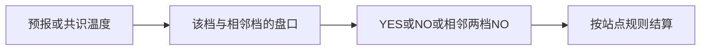

# Polymarket 邻档温度：WrongBy1Degree

- 归档日期：2026-11-23 Asia/Shanghai
- 链：Polymarket 天气市场的公开主页。本轮没有打开该账户的交易哈希、区块或 gas，不新写 chain id
- 策略类型：天气结果上的方向性投注，押的是「精确一度」附近的定价是否过满。不是锁定收益的完整集合套利
- 案例时间：[@linda6248130564](https://x.com/linda6248130564/status/2124751309295460637) 为北京时间 2026-11-23 14:26:02（UTC 06:26:02，由 UTC+8 换算，B）。公开主页核验在同日约 16:16 之后的下午
- 研究状态：官方主页字段已读。账户真实，累计 PnL 为正。原帖的 11 月命中、盈利日和天气榜名次没有按日重建，也没有打开排行榜全文。第三方聚合页样本不完整，不能代替官方页
- 证据等级说明：A 本次打开的公开页面或接口上的原始字段，B 由 A 精确计算，C 第三方叙述，D 未访问或未完整查看，E 假设示例
- 来源：[sources.md](sources.md)
- 归档规则：[docs/arbitrage-archive.md](../../../../docs/arbitrage-archive.md)

本文件是人工撰写的研究笔记。它不运行监控，也不会在以后自动改写自己。本次没有连接钱包、签名或下单。

写之前已对照 [套利索引](../../README.md)。这与 [天气市场](../polymarket-weather-markets/README.md) 同属天气盘，但是另一套口诀、另一个账户，不合并。那篇主要核验高价买 NO、机场站口径，以及 Happening9014、HondaCivic、HighTempTation。本篇不改那篇的原结论。也与 [mo-money 完整集合](../polymarket-mo-money-complete-set/README.md) 分开：精算师叙事和 YES+NO 小于 1 的机制不写入本账户。

时间线扫描覆盖北京时间 2026-11-23 12:09:08–16:17:04。下面的官方页和聚合页是此后同一下午（约 16:16 之后）打开的，不写成扫描开始时刻的快照。

## 结论

公开账户 WrongBy1Degree 存在，官方主页的 Total PnL 为 +$33.4K。这只说明该页在打开时显示累计盈利为正。它不是无风险套利，也不是「卖掉共识温度、只买相邻一档 YES」这条口诀的完整规则。

官方持仓同时有 YES 和 NO。同一日、同一城市可以同时持有相邻两档的 NO，例如广州 11-23 的 23℃ NO 与 24℃ NO；也有低价 YES，例如多伦多 11-23 的 13℃ YES 约 17.7¢。结算若落在已持有的某一档 NO 上，该档 NO 会亏。这比原帖的一句话更杂，不能把口诀当成全部交易规则。

若这种交易以后仍有正期望，条件至少包括：预报或盘口对「精确一度」过度集中，并且在机场站或数据源的结算口径、费用和资金占用之后仍有优势。这些条件本轮没有被证明稳定。作者自己也写了不是躺赚，天气变数大，规律随时失效。

原帖里的「本月 253 次命中 121 次、11 月 +21400 美元、17 个盈利日 5 天亏、天气榜第一」以及「5–10 月累计 2717 美元」，本次都没有独立复原。Rivo 只追踪到很少一部分成交，不能用它的 +$6.3K 去替换或反驳官方页的 +$33.4K。

## 策略类型

本案例是 Polymarket 城市气温盘上的方向性定价。原帖把它说成：别人押预报给出的温度，这个账户卖掉热门温度、买相邻一度。举例是市场共识首尔 3℃，它押的不是 3℃，而是 4℃。

它不是：

- 同一条件 YES 与 NO 数量对齐后 merge 的完整集合
- 高价买 NO 并持有到期的那一套宣传（见天气市场报告，账户不同）
- 已锁定的跨市场价差

两腿不原子，结果也不被一套互补代币锁死。公开持仓里的单边 YES、单边 NO，以及同一城市相邻两档 NO，都还是方向敞口。

## 时间、链与范围

| 项目 | 内容 | 等级 |
| --- | --- | --- |
| 原帖 | 2026-11-23 14:26:02 北京时间；UTC 06:26:02 | 北京时间为记录值；UTC 为 B |
| 回复中的主页 | https://polymarket.com/@WrongBy1Degre?via=k3H86f8 | C。用户名少了最后一个 e，且带推荐参数 |
| 本次打开的官方页 | https://polymarket.com/@wrongby1degree | A |
| 链上交易、区块、gas | 未观察 | D。本轮没有打开交易哈希 |
| 官方天气排行榜全文 | 未打开逐项复核 | D |
| 原帖的 253/121、17 盈 5 亏、+21400 美元 | 没有按日重建 | D |

## 原帖主张

下列句子来自帖文，不是已验证事实，等级都是 C。

- 钱包名 WrongBy1Degre，专门赌天气预报差 1 度。平台约 46 个城市气温盘。46 这个数本轮没有逐城点算。
- 大家押预报给出的温度；该账户卖掉热门温度，买相邻一度。例子：共识首尔 3℃，它押 4℃ 而不是 3℃。
- 本月出手 253 次，命中 121 次。11 月盈利 +21400 美元。17 个盈利日，5 天亏损。称稳坐天气榜第一。
- 5–10 月用相同思路累计 2717 美元。
- 作者写明：不是躺赚，天气变数大，规律随时失效。

本轮不把 121/253 换算成胜率。分子分母都还没有独立复原，换算只会多出一个看起来像结论的数字。

## 逐步机制

能从公开材料和持仓里分开的，只有下面几步。没有一步被证明成稳定正期望。

1. 气温盘按城市、当地日期和温度档结算。档与档互斥。买某一档 YES，是在押结算落在这一档；买 NO，是在押结算不落在这一档。
2. 原帖声称的优势是：盘口把概率过度堆在预报的那一度，相邻一度偏便宜。这是定价假设，本轮没有用预报原文和盘口深度去检验首尔 3℃ 那个例子。
3. 实际持仓并不只做「共识相邻的那一档 YES」。同一天可以同时持有相邻两档 NO，也可以持有低价 YES。
4. 持有到结算才知道哪一档为真。相邻两档 NO 不能互相锁成无风险：结算落在其中任何一档，对应的 NO 亏损。
5. 近样本若几乎全是吃单并且持有到结算，费用和资金占用都留在仓位里，不能从毛方向里再忽略一次。

上图是研究时的经济顺序，不是正在运行的程序，也不是该账户已被证明遵守的唯一规则。

## 真实案例

### 官方主页

2026-11-23 下午打开 https://polymarket.com/@wrongby1degree ，读到的字段如下。等级 A。

| 字段 | 页面值 |
| --- | --- |
| Joined | May 2026 |
| Positions Value | $9,905.57 |
| Biggest Win | $1,162.23 |
| Markets Traded | 13,881 |
| Total PnL | +$33.4K |
| Total Volume | 1.7M |

Joined 只写到月份，本轮没有更细的开户日。Total PnL 和 Total Volume 是页面简写，不是逐笔审计后的现金。Positions Value 是打开时的持仓市值，不能与 Total PnL 相加，也不能当成已经提取的利润。

公开持仓同时出现 YES 和 NO。点名的例子：广州 11-23 的 23℃ NO 与 24℃ NO 同时持有；多伦多 11-23 的 13℃ YES 约 17.7¢。本轮没有把整页持仓抄成全表，这两个例子只说明规则比口诀更杂。

### 地址从哪里来

官方主页这次没有直接读到 0x 字段。地址 `0x0a0c42f6b1da5a633ec1a4d45ba76eb486c1a853` 来自聚合页。Rivo 与 ProbPocket 都把该地址标成 WrongBy1Degree。可以合理视为同一账户，但地址等级是 C，来源是聚合页，不是官方主页上的原始字段。

### 第三方统计不能当成全账户账本

Rivo 页标 Stats as of Nov 21, 2026, 12:19 PM ET。它只追踪到 1,012 笔，已结算约 +$6.3K，胜率 54%，典型单笔 $15，平均入场 34¢。官方页是 13,881 个市场、Total PnL +$33.4K、成交 1.7M。两边的「笔」和「市场」还不是同一单位。差距说明 Rivo 明显少计。不用 +$6.3K 去反驳或替代 +$33.4K。

ProbPocket 页标 data as of 2026-11-22。它写的官方净 PnL（已扣费）是 +$22.0K，成交额 $1.23M，7 日 PnL $10K，30 日 PnL $25K，费用下限 ≥ $3,405。近 500 笔全部是 taker、全部是天气、持有到结算，卖出占周转 0%。这些是该站的样本描述，等级 C。

同一页还给了两种胜率：95%（n=400）和 42.6%（n=900）。必须带着样本量一起读。不能单独写成这个账户的总胜率。两种口径差这么多，本身就说明换一批样本结论会变。

官方 Total PnL +$33.4K 与 ProbPocket 在 11-22 写下的 +$22.0K 不同。持仓市值约 $9,905.57。差异可能来自未实现盈亏、时点或口径。本轮不把这些数加总，也不写成已经核对过的对账。

原帖「5–10 月累计 2717 美元」，和 ProbPocket 在 11-13 已记录的约 +$10.1K 终身 PnL，以及当前官方 +$33.4K，对不齐。这段历史分成未独立复原，保持 C，不能当成已核对的月度账。

原帖「11 月 +21400、253 笔命中 121、17 盈 5 亏、天气榜第一」没有按日重建，排行榜全文也没有逐项打开。保持未验证。

## 收益分层

| 层 | 本案例能写的数 | 等级 | 还没有包含 |
| --- | --- | --- | --- |
| 官方页累计 PnL | +$33.4K | A，页面简写 | 未实现与已实现是否分开、费用是否已含、能否提取 |
| 持仓市值 | $9,905.57 | A | 不是利润，不能与上一行相加 |
| 最大单笔赢利展示 | $1,162.23 | A | 不是策略的典型利润，也不是月收益 |
| ProbPocket 所称官方净 PnL | +$22.0K，时点 2026-11-22 | C | 与官方页 +$33.4K 不同，本轮未轧平 |
| Rivo 已结算 | 约 +$6.3K，只覆盖它追踪到的 1,012 笔 | C | 不能代表 13,881 个市场 |
| 原帖 11 月与 5–10 月 | +21400 美元；2717 美元 | C，未复原 | 不能进入已核对收益 |
| 经营收益 | 未编制 | D | 没有研究、失败尝试、资金占用的账单 |

三套正数同时存在，是因为样本和口径不同。只保留差异，不做加总。

## 费用、单位与价格口径

- Total PnL 的「+$33.4K」和 Total Volume 的「1.7M」是主页简写。K 和 M 没有在本轮展开成精确到分的接口字段。
- Positions Value、Biggest Win 使用页面给出的美元和美分。
- 多伦多 13℃ YES「约 17.7¢」是持仓展示上的价格，不是可成交的深度，也不是结算概率。
- ProbPocket 的费用下限 ≥ $3,405 是第三方给出的下限，等级 C。本轮没有逐笔重算吃单费，也不把别的天气报告里的费率表套到这个账户上当作它的账单。
- 近 500 笔若确是全部吃单、卖出占周转 0%，费用发生在买入时，并且资金要留到结算。这个「若」来自 ProbPocket，不是本轮链上复点。
- 份数、市场数和美元继续分开。13,881 是页面上的 Markets Traded。Rivo 的 1,012 是它自己的笔数。不能把二者相减当成漏记笔数。

## 资金门槛

初始本金未知。deposits 一类字段本轮没有打开。Positions Value $9,905.57 只是打开时的持仓市值。

原帖没有给出这个账户的本金。不能用 Total Volume 1.7M 或成交额 $1.23M 倒推所需资金。持有到结算会占用资金，占用多久取决于每个城市的当地结算日，本轮没有逐市场计算。

最低本金不估计。

## 技术架构

下面是以后只读研究要分开的部分，不是本仓库已经运行的系统。

| 部分 | 作用 |
| --- | --- |
| 市场身份 | 城市、当地日期、温标、温度档、结算站 |
| 盘口 | 共识档和相邻档的价格与深度，过期盘口要丢掉 |
| 持仓 | YES、NO、同一城市相邻档是否同时存在 |
| 费用 | 吃单还是挂单，费用是否已含在第三方净 PnL 里 |
| 结算 | 站点、舍入和日期。规则见天气市场报告，本轮没有为这个账户重读某一城的规则原文 |
| 会计 | 官方页、ProbPocket、Rivo 分列，禁止相加 |

## 可执行性与自动化部署评估

- 开发部署：只读监控公开盘口和结算源，在规格写清之后可以做。本轮没有完整规格，不写工期，也不写费用承诺。
- 专用脚本：可以记录某城某日各档价格、预报值和结算结果。不能从「相邻一度」四个字生成下单指令。广州那种同时持有两档 NO 的库存，脚本如果只复述原帖口诀，就会跟错。
- 通用助手或 Grok Bot：适合整理规则和对照公开页面。不应持有私钥，不应无人值守下单，也不应复制这个钱包。跟单或自动下单不适合：规则比口诀更杂，优势是否稳定没有证明，推荐链接还有利益冲突。

本仓库的笔记不部署这些程序。

## 风险

- 方向与尾部：极端气温、预报突变、相邻档同时押错。高胜率如果存在，也不是锁定收益。
- 规则：结算站、舍入和日期会改变「差 1 度」的含义。本轮没有重证这些规则保持不变。
- 费用与吃单：近样本几乎全是吃单时，费用不可忽略。卖出占比若接近 0，亏损要留到结算。
- 资金占用：持有到结算。持仓市值约 9,905.57 美元是占用的一种展示，不是上限。
- 样本选择：Rivo、400 笔样本和 900 笔样本给出不同画像。只引用 95% 会误导。
- 口径：+$33.4K、+$22.0K、约 +$6.3K 不能挑一个好听的写成已审计利润。
- 幸存者与榜单：天气榜第一没有打开全文核对。宣传账户是被选出来展示的。
- 流动性：低价 YES 的 17.7¢ 不代表这个价格上还有足够深度。

## 利益冲突

本帖可核对的推广参数是回复里的 `via=k3H86f8`。打开研究用的是去掉推荐参数后的官方用户名 https://polymarket.com/@wrongby1degree 。

同一作者 @linda6248130564 的其他帖还带 GMGN 邀请链 https://gmgn.ai/r/tx168 ，以及 Kreo 跟单机器人和电报群。那些链接本帖正文没有当作天气账单来用。引流不自动否定「精确一度可能被过度定价」这句逻辑，但也不能把本账户包装成已验证、可跟单的机会。本轮没有证据表明推荐参数已经产生佣金到账，也不能无视这个动机。

## 验证方案与停止条件

本次已经做的，只是阅读原帖、打开官方主页，并记录 Rivo 与 ProbPocket 页上的字段。没有签名，没有下单，没有复原 253/121。

以后若继续，只做只读和纸面工作：

1. 从官方页或官方接口保存地址字段。在官方页读到 0x 之前，聚合页地址保持 C。
2. 按城市和当地日保存各档价格、预报和结算原文。失败日和未结算日留在样本里。
3. 费用按该笔是 maker 还是 taker 单列。第三方净 PnL 若已扣费，不再扣一次。
4. 胜率必须写样本量。95%（n=400）和 42.6%（n=900）不能合成一个数。
5. 排行榜名次只有在打开官方榜全文之后才能写。

出现下列任一情况就停止：有人要求把笔记当成当前可下单机会；要求复制该钱包；要求用 Rivo 的 +$6.3K 替换官方 +$33.4K；要求把未复原的 253/121 或 17/5 写成事实；经营收益仍没有成本材料却要写成利润。

## 交叉链接：多模型价值投注（2026-11-24）

2026-11-24 另有一份投资笔记：[天气多模型价值投注](../../../investment/2026/chenke-polymarket-weather-multimodel-valuebet/README.md)。那是另一个账户、另一套规则：用多个预报模型估计档位概率，对照市场价格。本篇仍是淡化共识温度、改押相邻 1 度。原结论不变，两篇不合并。

## 来源

细节在 [sources.md](sources.md)。官方页字段以 2026-11-23 下午打开的 https://polymarket.com/@wrongby1degree 为准。原帖主张以帖文为准，等级 C。

## 未解决问题

1. 官方主页没有读到 0x。地址仍来自聚合页。
2. 13,881 个市场没有逐个复原，1.7M 成交量没有展开成精确美元。
3. +$33.4K 与 +$22.0K 的差额没有轧平。未实现、时点和口径都还可能。
4. 11 月 +21400、253/121、17 盈 5 亏、天气榜第一未验证。
5. 5–10 月 2717 美元未独立复原。
6. 首尔 3℃ / 4℃ 的例子没有对照当时的预报和盘口。
7. 约 46 城没有逐城点算。
8. 没有全量持仓表，广州和多伦多只是打开时看见的例子。
9. 结算站规则本轮没有为这个账户单独重读。
10. 推荐参数是否产生佣金，未知。

## 复核记录

| 日期（Asia/Shanghai） | 检查 | 改动 | 仍开放 |
| --- | --- | --- | --- |
| 2026-11-23 | 阅读原帖；打开官方主页 @wrongby1degree；记录 Rivo 与 ProbPocket 页上字段。不把第三方样本当成全账户账本 | 新建本目录。与天气市场、完整集合报告交叉链接，不合并 | 上一节各项 |
