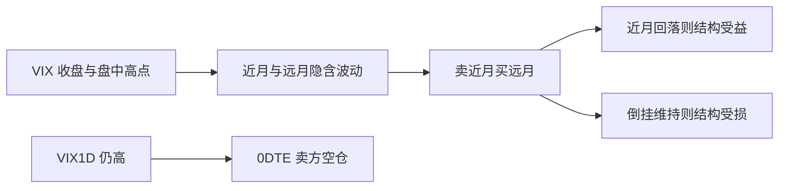

# 周五 VIX 盘中触及 40：结构观察、历史自述与日历价差

- 归档日期：2026-11-22 Asia/Shanghai
- 市场与标的：Cboe Volatility Index（VIX）及其期限结构；文中可执行倾向指向指数期权的日历价差，以及 0DTE 卖方在 VIX1D 仍高时的空仓。没有指定月份、行权价或合约代码
- 策略类型：期权/波动率结构观察，加上对“VIX>40 逆向买入”历史规律的讨论。文中给出的倾向是卖近月、买远月的日历价差。不是套利，也不是已验证交易系统
- 案例时间：时间线帖 2026-11-22 12:19:33 Asia/Shanghai（2026-11-22 04:19:33 UTC）。文中“本周五”对应美国交易日 2026-11-20，北京时间 2026-11-21 清晨收盘
- 研究状态：文章主张已按本轮指定材料记录。2026-11-20 的 VIX 盘中 40.03、收盘 35.89 沿用仓库既有核验。207/9,283 的除法成立，但 207 这个天数没有用 Cboe/FRED 原始序列独立复点。绩效表、结构指标和资格自述未复现。2022 年标普全年跌幅与公开常用口径不符
- 证据等级说明：A 本次打开的公开页面或原帖/文章上的原始字段，B 由 A 精确计算，C 第三方叙述或作者自述，D 未访问，E 假设示例

本文件是人工撰写的研究笔记。它不运行交易，不构成投资建议，也不会在以后自动改写自己。

这是 `@Amy6Tina`（显示名“期权坤哥 | Sober CFA”）的一篇新文章，不并入此前的 [财报 IV 回落与 VIX/IV/HV](../soberoption-earnings-iv-crush/README.md)。两篇作者相同，主题不同：旧文解释财报后个股 IV 回落如何让方向正确的 Call 仍然亏损；本篇讨论 VIX 触及 40 之后的历史分布、结构指标和日历价差。

本篇也与 [VIX>40 逆向加仓与 QQQ/TQQQ 长期配置](../vix-contrarian-qqq-tqqq/README.md) 讨论同一个市场日，但不合并。那篇的公开规则是方向性持有 QQQ/TQQQ，并用 VIX>40 作为加仓过滤器，仓位细节放在付费区和 Discord。本篇的可执行倾向是波动率期限结构上的日历价差，以及 0DTE 卖方继续空仓。主张、工具和证据都分开归档。

## 结论

这是一篇有教学价值的波动率结构讨论。它把“VIX 高”拆开：近月与远月可以不一样，做市商仓位和偏斜也不等于一个已经写完的买入指令。部分历史极值可以对上公开二级记录，2026-11-20 的盘中高点与收盘也与仓库里已经核对过的行情一致。

不能据此下单。文中的持有期回报、胜率、回撤和“平时空仓、只在恐慌买入”的复合收益率，全部是作者自述，本轮没有样本和代码，一律不能当成已验证绩效。作者写“2022 年标普全年跌 25.4%”，这与公开常用口径不符：2022 年标普 500 价格回报约 -19.4%，含股息总回报约 -18.1%。日历价差只写了方向（卖近月、买远月），没有月份、合约、仓位、保证金、止损和费用。期限结构可以继续倒挂，近月波动可以不回落。

因此本篇评为：**有教学价值的波动率结构讨论，部分历史极值可核对，但绩效数字未复现，2022 年标普跌幅有明显口径错误，日历价差规则不完整，不能包装成已验证机会，不应自动下单。**

作者自己写了更要紧的限制：不要把 VIX>40 当成完整策略；只在恐慌时买入并持有，长期复合远低于买入持有。按作者给出的数字，1993–2026 年这种做法的复合是 4.70%/年，买入持有是 10.80%/年，并且有 73.5% 的时间空仓。这些数字同样未经复现，但它们是作者自己的限制，应当保留。它削弱了把 2026-11-20 这次盘中触 40 当成买入信号的理由。

## 策略类型

- 属于：对 VIX 水平、期限结构和若干偏斜指标的读后观察；若按文中倾向去做，是卖出较近到期、买入较远到期的日历价差，赚的是近月隐含波动相对远月回落，不是指数方向本身。
- 适用环境（只按机制，不表示这次已经出现可下单的价）：近月隐含波动明显高于远月，投资者能承受保证金、价差和“倒挂不修复”的结果，并且把 0DTE 卖方单独看成尾部风险而不是收租。
- 不属于：无风险套利、跨市场锁定价差、已完成回测的量化系统，或“VIX 盘中一碰 40 就买股票/卖 put”的完整规则。
- 相邻但不同：Jonylin 的 QQQ/TQQQ 逆向加仓是方向性指数配置。同一作者此前的财报 IV 文章是个股事件期权的风险教育。两篇都不并入本案。

## 时间与标的

| 项目 | 内容 | 等级 |
| --- | --- | --- |
| 时间线帖 | https://x.com/Amy6Tina/status/2124357091360170137 ，2026-11-22 12:19:33 Asia/Shanghai（2026-11-22 04:19:33 UTC） | A（本轮指定已读的帖） |
| 文章 | https://x.com/i/article/2124356341057966080 ，标题《周五 VIX 破 40 了，后续怎么走？》 | A（本轮指定已读的文章） |
| 作者显示名 | 期权坤哥 \| Sober CFA，句柄 `@Amy6Tina` | A（与既有报告中的显示名一致；CFA 资格本身未核验） |
| 2026-11-20 VIX | 盘中最高 40.03，收盘 35.89。美国交易日 2026-11-20，北京时间 2026-11-21 清晨收盘。与 [VIX>40 逆向加仓](../vix-contrarian-qqq-tqqq/README.md) 已打开的 Yahoo Finance 历史表和 Cboe 产品页一致 | A/B（沿用既有核验，本篇不改这些数字） |
| 作者的天数 | “1990 年以来约 9,283 个交易日，207 天收盘在 40 以上，占 2.2%” | 除法见下节，B；天数本身不是独立复点 |

写档时再次调用 X 读取接口被开发者计费权限拒绝，没有重拉这两条的原始 JSON。上表的链接、时间和标题按本轮已经读过的材料记录。见 [sources.md](sources.md)。

## 历史数字：哪些算术成立，哪些没有复点

### 天数占比

207 / 9,283 = 0.0222988，即 2.23%，作者写成 2.2%，算术成立，等级 B。这只说明“207 除以 9,283 约等于 2.2%”，不说明 207 和 9,283 已经用官方日线数过。

本轮检索到的第三方综述使用另一个分母。VIXChart 写：1990-01-02 至 2026-11-20，共 9,321 个交易日，收盘在 40 及以上的份额为 2.2%，数据来源栏写的是 Cboe 日频历史，但该站不是 Cboe 原文件。historyofmarket 的同口径综述把“收盘高于 40”写成 207 天，占 9,321 天的 2.2%。207 / 9,321 = 0.0222079，也显示为 2.2%。研究材料还点名 Prism；本档没有另开一份独立的 Prism 原文。

因此：207 这个分子与上述第三方综述一致，不能写成已经独立复算。9,283 与 9,321 相差 38 天，分母差异要留在账上。起点是否含 1990-01-02、是否把某日算进“收盘在 40 以上”、以及 2026-11-20 当天（收盘 35.89，本来就不应计入）有没有被放进样本，都会造成这种差距。本轮没有下载 Cboe 或 FRED 的 VIXCLS 原始序列逐日点数。检索时见到 FRED `VIXCLS` 的表头，摘录中的日期范围写到 2026-11-19；该文件没有被用来复核 207。

### 极值

| 主张 | 本轮看到的材料 | 等级 |
| --- | --- | --- |
| 收盘最高 82.69（2020-03-16） | Macroption、VIXChart 都写这一天、这一收盘。Bloomberg 2020-03-16 报道的摘录也写收盘 82.69。与常见官方记录一致。本轮没有打开 Cboe 原始日线文件 | 多家二级来源一致，不升为 A |
| 盘中最高 89.53（2008-10-24），当日收盘 79.13 | Macroption 已打开：盘中高点 89.53，并写当日收盘 79.13，且把 79.13 列为历史第四高收盘。VIXChart 的纪录栏同样写盘中 89.53。研究材料还提到 VIX and More；本档没有另开该站页面。没有打开 Cboe 逐笔或盘中文件 | C，不要写成 A |
| 2026 年盘中高点 40.03、2026-11-20 收盘 35.89 | 既有报告的 Yahoo / Cboe 页面，以及本轮打开的 VIXChart 年度表（2026 年 High 40.03、Close 35.89） | 40.03 与 35.89 沿用既有 A/B；VIXChart 只作交叉，仍是二级站点 |

VIXChart 自己写明：年度表里的 High / Low 是盘中极值，Open / Close 是该年第一个和最后一个交易日的收盘，不是该年最高或最低收盘。所以 2022 年那一行的 High 38.94 是盘中口径，不能拿来核对或否定作者说的“2022 年收盘最高只有 36.45”。

### 绩效自述，全部未复现

下面每一项都是作者自述。本轮没有事件表、持有期价格序列或代码。等级全部为 C，不能写成已验证绩效。

| 作者写法 | 等级 |
| --- | --- |
| 12 次首次触发后持有 12 个月，平均 +22.1%，中位 +23.0%，10 胜 2 负 | C |
| 分年回报、250 日内回撤 | C，本轮未逐项列出或复算 |
| 等到 VIX 回落到 30 以下：+16.8%，胜率 90% | C |
| 1993–2026 年“平时空仓，只在恐慌买入”复合 4.70%/年，买入持有 10.80%/年，73.5% 的时间空仓 | C |

这些数字与 Jonylin 帖里的“历史上一共只有 16 次”不是同一定义。一个在数“首次触发后持有 12 个月”的样本，一个在数“自诞生以来 VIX>40 的次数”。两边都还没有用官方日线复点，不能互相当成已经对上的官方次数。

### 明确错误，以及一处未核验

作者写“2022 年标普全年跌 25.4%”。公开常用口径不是这个数。美联社 2022-12-30 的年终报道写：标普 500 全年亏损 19.4%，若计入股息则为 18.1%。CNBC 同年终报道把价格回报写成下跌 19.44%。本轮没有打开标普官方全年总回报文件，所以 -19.4% 与 -18.1% 保持在常用新闻口径，等级 C；它们已经足够说明 **-25.4% 不是 2022 年标普 500 的全年价格回报，也不是含股息总回报**。这个错误写进结论，不因为文章其余部分有教学价值而被盖住。

文中另称 2022 年“VIX 收盘最高只有 36.45、从没触发”。本轮没有用官方日线独立复核这个收盘高点，标为未核验。上面已经说明，二级网站年度表里的 2022 年盘中高点不能代替这次复核。

### 盘中破 40、收盘没破

作者写：盘中破 40、收盘没破，历史上出现过三次，事后都是不错的买点。样本只有三例。本轮没有复核那三次的日期，也没有复算事后回报，不能当成可执行规则。即便三例属实，样本外仍会失效。

按作者自己的这条标准，2026-11-20 正是又一次盘中破、收盘未破：最高 40.03，收盘 35.89。不能把这一天回填成“已经被那三次验证过的买点”。它是规则所要面对的新样本，不是规则的证据。

### 结构指标与做市规模

做市商负 gamma、野村数据“2019 年以来最高”、VIX 涨幅超过八成来自标普下跌对长期期权定价的连锁影响、六个结构指标里五个在极值而 SKEW 在中位、SKEW 未到 150：这些是作者叙述或“内部网站”配图上的读数，也可以是对他人研究的转述。本轮没有看到可核对的原图数据，也没有看到野村原文。等级 D/C，不能当作已经验证的信号。负 gamma 会让做市商在下跌时被动卖出、在上涨时被动买入，这是教科书里的机制描述；机制成立与否，和“这次的读数已经创 2019 年以来新高”是两件事。后者没有原件。

“一个月 20 亿美金”的做市规模、CFA 或从业资格、以及 12 年实盘，本轮都没有独立核验。显示名里的 “CFA” 只证明字符串存在。

## 逐步机制

文中能读出来的顺序是：

1. 用收盘而不是盘中来定义“VIX 在 40 以上”。2026-11-20 收盘 35.89，按这个定义没有站上 40。
2. 作者同时讨论一条更松的观察：盘中曾经到过 40、收盘没有。他把它说成历史上很少见的买点。上一节已经说明，这条不能执行。
3. 可执行倾向改到波动率期限结构：卖出较近的到期，买入较远的到期，也就是日历价差。它赌的是近月隐含波动相对远月回落，或者期限结构的倒挂收窄。它不是在抄指数的底，也不是无风险套利。
4. 对 0DTE 卖方，作者的态度是：VIX1D 仍高时继续空仓。这是风险提示。空仓本身不产生正期望，也不是一个盈利系统。本轮没有单独读取 2026-11-20 的 VIX1D 收盘，不补这个数字。

图只表示文章里的倾向。没有月份、行权价、张数和止损，所以它不是已经可以跑的流程。

日历价差还留下这些没有写明的风险：期限结构可以继续倒挂；近月波动可以不回落；卖出的近月腿仍有 gamma 和跳空；保证金、买卖价差和展期费用都未给出。结构“会自己修复”不是交易规则。

## 真实案例

本轮没有作者的期权成交单。2026-11-20 的 VIX 路径是可以核对的市场事实，不是一笔已经完成的日历价差。

同一市场日里，Jonylin 的框架仍以收盘是否大于 40 作为公开过滤器，当时收盘没有触发。两篇文章面对的是同一根 K 线，给出的工具不同。不能把日历价差的教学说明，写成 QQQ 或 TQQQ 已经发出买入信号。

## 收益分层

| 层 | 定义 | 数量 | 单位 | 等级 | 这个数字还没有包含 |
| --- | --- | --- | --- | --- | --- |
| 作者的 12 个月持有 | 首次收盘触发后持有 12 个月 | 平均 +22.1%，中位 +23.0%，10 胜 2 负 | 作者未写明是指数价格还是总回报 | C | 费用、滑点、样本定义；本轮未复现 |
| 作者的“等到 30 以下” | VIX 回到 30 以下再结算 | +16.8%，胜率 90% | 同上 | C | 窗口与费用；未复现 |
| 作者的择时复合 | 1993–2026 只在恐慌时持有 | 4.70%/年，对比买入持有 10.80%/年 | 年复合 | C | 空仓期间的收益定义；未复现 |
| 可复制规则的净收益 | 有合约、仓位、保证金和费用的日历价差 | 未定义 | 不适用 | D | 全部执行项都还没有 |

上表前三行是作者的限制和宣传混在一起的自述。4.70% 对 10.80% 如果属实，说明“只在恐慌买入”长期跑输一直持有。本轮既不把 22.1% 当成可复制收益，也不把 4.70% 改写成已经审计的业绩；只保留它作为作者承认的策略缺口。

## 费用、单位与价格口径

- VIX 的 40.03 和 35.89 是指数点位，不是期权权利金。
- 日历价差的权利金、合约乘数、保证金和佣金，文章没有给，本轮不假设。
- 2022 年标普的 -19.4% / -18.1% 是新闻转述的全年价格回报和含股息总回报，不是从标普官方总回报序列里重新算出来的。
- 207 / 9,283 与 207 / 9,321 只做除法，不把任何一个分母升级成官方交易日计数。

## 资金门槛

未知。文章没有账户最低资金、单笔保证金或最大亏损。“一个月 20 亿美金”是未核验的做市规模自述，不能当成读者的资金门槛，也不能当成流动性已经足够的证据。

## 技术架构

只读跟踪需要公开的 VIX 日频开高低收，以及一份公开的波动率期限结构（近月、远月隐含波动或 VIX 期限）。不需要券商接口。

本次没有连接券商，没有下单，没有按文末微信去获取“内部网站”数据。

## 可执行性与自动化部署评估

- **开发部署难易**：做一个只读记录并不难，例如每个美国交易日记下 VIX 收盘和盘中高点，并对照公开期限结构是否仍倒挂。没有合约规格时，不估计能自动交易的工期。
- **专用自动化脚本**：适合收盘后写入“收盘是否大于 40、盘中是否曾大于 40”。不适合自动卖出近月、买入远月，也不适合在脚本里把“结构会修复”写成下单条件。
- **通用 AI 助手或 Grok Bot**：适合解释日历价差和证据等级，并指出 2022 年跌幅口径、未复现的胜率和利益冲突。不应按文中微信 April1336，或按“结构会自己修复”，去卖 put 或建立日历价差。不应连接券商。

不适合自动实盘的原因：规则缺少合约和风控；绩效未复现；盘中触及 40 被作者自己的收盘定义和自己的长期复合比较同时削弱。

## 风险

- **口径错误**：把 2022 年标普跌幅写成 -25.4%，会夸大“高 VIX 之年股市一定更差”的故事。该年 VIX 有没有收盘站上 40，本轮仍未核验。
- **样本极小**：三次“盘中破、收盘未破”即使属实，也撑不起一条买入规则。2026-11-20 是这条叙述下的新样本，不能回填成证据。
- **期限结构不回归**：卖近月、买远月在倒挂加深或近月波动维持高位时亏损。这不是套利，没有自然的收敛期限。
- **0DTE 与 gamma**：作者让 0DTE 卖方空仓，说明他并不认为高 VIX1D 是可以继续卖的环境。空仓提示不能被改写成卖波动的系统。
- **未核对的结构图**：负 gamma、野村、SKEW 中位和“五个指标在极值”都还没有原件。用它们解释当天走势，和用它们发单，距离很大。
- **历史自述的定义差**：12 次、16 次、9,283 天、9,321 天，换一个事件定义就会变。在官方序列复点之前，都不能写成规律。
- **利益冲突**：见文末专节。引流不自动否定上面可以核对的行情和算术，也不把未复现的绩效变成事实。

## 验证方案与停止条件

只做只读核对：

1. 继续用既有报告里的 2026-11-20 收盘 35.89、盘中 40.03，不改这些数字。
2. 若要复核 207 天，下载 Cboe 或 FRED 的日频收盘，事先写明起点、是否含等号、以及 2026-11-20 如何处理，再计数。在那之前保持“与第三方综述的分子一致，但未独立复点”。
3. 盘中 89.53 和当日收盘 79.13 在打开 Cboe 盘中或日线高点文件之前保持 C。
4. 绩效表需要作者的事件日期和指数序列才能复现。没有这些材料，不把 +22.1% 或 4.70% 写进可执行收益。
5. 日历价差若要评估，先补月份、行权价、张数、保证金和费用。本笔记不补。

出现以下情况即停止：

- 把未复现的胜率、+22.1% 或 4.70% 写成已验证成绩。
- 用 -25.4% 描述 2022 年标普全年回报。
- 把三次盘中样本或 2026-11-20 当天写成已经验证的买点。
- 要求助手按微信或“结构会修复”卖出期权、做日历价差或连接券商。

## 来源

细节见 [sources.md](sources.md)。正文只保留短表：

| 来源 | 访问结果 | 支撑的主张 | 明确不支撑的主张 |
| --- | --- | --- | --- |
| `@Amy6Tina` 时间线帖与文章 | 本轮指定已读；写档时 X 接口未能重拉 JSON | 文章在讨论 VIX 触及 40 后的结构和日历价差 | 不证明绩效表、野村数据或资格 |
| 仓库既有 VIX 报告中的 Yahoo / Cboe 页面 | 沿用 2026-11-21 已打开的字段 | 2026-11-20 最高 40.03、收盘 35.89 | 不新造报价 |
| VIXChart；historyofmarket | VIXChart 已打开。historyofmarket 为检索到的页面摘录 | 9,321 个交易日、40 以上约 2.2%；后者写出 207 天。收盘纪录 82.69 | 不是 Cboe 原文件，不能把 207 升为独立复点 |
| Macroption | 已打开 | 收盘纪录 82.69；2008-10-24 盘中 89.53、收盘 79.13 | 页面数据截止说明写到 2025-04-17，且不是 Cboe 逐笔文件 |
| 美联社、CNBC 的 2022 年终报道 | 检索到报道原文摘录；美联社全文拉取超时 | 全年价格回报约 -19.4%（CNBC 写 -19.44%），含股息约 -18.1% | 不是标普官方总回报文件；已足够否定 -25.4% |

## 未解决问题

- 9,283 与 9,321 相差的 38 个交易日具体是哪些日期。
- 207 天尚未用 Cboe/FRED 原始序列复点。
- 12 次首次触发的日期、标的和费用口径。
- “三次盘中破、收盘未破”的日期和事后回报。
- 2022 年 VIX 收盘最高是否为 36.45。
- 野村原文、六个结构指标的原图，以及 2026-11-20 的 VIX1D 数值。
- 微信 April1336 背后的账户主体，以及“三大市场实盘业绩展示”里的账单。本轮不把这些当作本案证据，也不去添加该联系人。

## 复核记录

| 日期（Asia/Shanghai） | 检查 | 改动 | 仍开放 |
| --- | --- | --- | --- |
| 2026-11-22 | 按指定文章归档；沿用既有 VIX 40.03/35.89；核算 207/9283 与 207/9321；打开 Macroption、VIXChart，并对照美联社与 CNBC 的 2022 年标普年终口径。未复现绩效，未下载 Cboe/FRED 逐日点数 | 首次归档。与财报 IV 报告、QQQ/TQQQ 报告交叉链接，不合并 | 上节未解决问题仍开放 |

## 利益冲突与范围说明

文末导流微信 **April1336**，备注写“VIX”，并链到往期文章，其中包含“三大市场实盘业绩展示”。配图称数据来自内部网站，未经授权不要使用。这是利益冲突，单列在此。

引流不自动否定文中可以核对的部分：2026-11-20 的 VIX 路径、207/9,283 的除法、以及日历价差在定义上是期限结构交易而不是套利。引流也不自动证实未附原件的绩效、野村读数、做市规模和从业资格。本笔记不添加该微信，不打开内部网站，不把往期“实盘业绩”转写成收益。

评估范围只到这篇 2026-11-22 的文章。不与 [财报 IV 回落与 VIX/IV/HV](../soberoption-earnings-iv-crush/README.md) 合并，也不与 [VIX>40 逆向加仓与 QQQ/TQQQ 长期配置](../vix-contrarian-qqq-tqqq/README.md) 合并。
