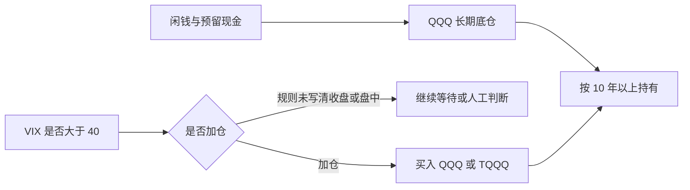

# VIX>40 逆向加仓与 QQQ/TQQQ 长期配置

- 归档日期：2026-11-21 Asia/Shanghai
- 市场与标的：美国上市 ETF，主要是 Invesco QQQ Trust（QQQ，追踪 Nasdaq-100）与 ProShares UltraPro QQQ（TQQQ，每日 3 倍 Nasdaq-100）；触发指标为 Cboe Volatility Index（VIX）
- 策略类型：长期指数方向性配置，叠加公开的波动率阈值逆向加仓；不是无风险套利，也不属于结构锁定收益
- 案例时间：公开规则原帖 2026-11-04 08:39 Asia/Shanghai（2026-11-04 00:39 UTC）；本轮时间线相关帖 2026-11-21 04:54 至 07:50 Asia/Shanghai；核验所用行情为 2026-11-20 美国常规交易时段收盘（约 2026-11-21 05:00 Asia/Shanghai）
- 研究状态：公开规则已核对；若以 VIX 收盘价 > 40 为触发条件，则 2026-11-20 收盘尚未触发；加仓数量、QQQ/TQQQ 配比和退出规则未在公开帖中给出；“历史上共 16 次、长期视角胜率很高”未用官方日频序列独立复点
- 证据等级说明：A 本次打开的公开页面或接口上的原始字段，B 由 A 精确计算，C 第三方叙述，D 未访问，E 假设示例

本文件是人工撰写的研究笔记。它不运行监控，不构成交易建议，也不会在以后自动改写自己。

写之前已追到引用原帖与作者投资框架长文，并对照仓库 `main`、`latest-reports` 与开放 PR 去重。仓库此前没有同主题报告。

## 结论

这是一套方向性、需要长时间持有美股科技成长指数的配置思路，再叠加一条公开的逆向加仓规则：当 VIX 恐慌指数大于 40 时，视为“极端恐慌窗口”并考虑买入。它的盈利来源不是定价错误的锁定价差，而是作者所假设的前提：纳斯达克 100 在足够长的时间里仍能上涨，投资者用闲钱和预留现金在恐慌期加仓，并且能够承受中间的大幅回撤。这些前提成立与否，本身就是方向风险和期限风险。

截至 2026-11-20 美国常规交易收盘，VIX 收盘价为 35.89，盘中最高 40.03。若把原帖里的“VIX＞40”理解成收盘价阈值，则该规则此刻尚未触发；若理解成盘中触及，则只是刚碰到 40，且作者并未写明以收盘还是盘中高点为准。QQQ 相对 2026-10-06 收盘高点 759.66 回撤 19.9050%，相对当日盘中高点 762.86 回撤 20.2409%，与时间线上“从历史高点回调了 20%”的表述大致相符。TQQQ 同日收盘 41.20，较页面所示 52 周高点 88.09 回撤 53.2297%，同日跌幅 15.94%，明显大于 QQQ 的 5.67%，这正是每日 3 倍杠杆在下跌中的放大效应，不能把它和 QQQ 当成同一风险资产。

公开文本没有给出加多少、用 QQQ 还是 TQQQ、如何再平衡、以及 VIX 维持高位或指数继续下跌时如何处理。更具体的仓位方法被作者放到付费订阅和 Discord。因此，即使有人认同“长期持有美股指数、恐慌时用闲钱加仓”这一类常见思路，本轮也只能把该策略评为：**规则不完整、阈值按收盘价尚未触发、杠杆路径与利益冲突均未排除的待验证方向性方法**，不能包装成已经验证的买入机会。

## 策略类型

- 属于：长期、方向性的指数基金配置；可选叠加每日重置的 3 倍杠杆 ETF；用 VIX 水平作为逆向加仓的公开过滤器。
- 适用环境（按作者公开表述）：投资人拥有闲钱和持续现金流、投资期限按 10 年以上理解、能够接受美股“牛长熊短”同时也包含剧烈回调，并且把研究重点放在宏观而不是个股。
- 不属于：无风险套利、市场中性、期权结构对冲后的锁定收益、已完成回测验证的量化信号，或可直接复制的完整交易系统。
- 相邻但不同的内容：同一时间线里还有持有者的心态分享、以及宏观研究机构关于“这是被恐慌放大的调整、不是 AI 泡沫破裂”的评论。那些是观点或情绪管理，不是本报告评估的可重复规则。

## 时间与标的

| 项目 | 内容 | 等级 |
| --- | --- | --- |
| 公开规则原帖 | https://x.com/Jonylin007/status/2117778834523074858 ，2026-11-04 00:39:55 UTC，2026-11-04 08:39:55 Asia/Shanghai。当时作者引用的“当前 VIX：20.83”与 Yahoo Finance 的 2026-11-03 收盘价 20.83 一致 | A |
| 投资框架长文 | 帖 https://x.com/Jonylin007/status/2116186096144953701 ，文章 https://x.com/i/article/2116182379903524864 ，2026-10-30 15:10:56 UTC，2026-10-30 23:10:56 Asia/Shanghai | A |
| 本轮时间线帖 | `@Jonylin007` 在 2026-11-21 07:13 至 07:50 Asia/Shanghai 连续讨论逆向买入、现金抄底和继续持有；`@tychozzz` 在 04:54 与 06:14 给出 QQQ 回撤约 20%、VIX 逼近 40、纳斯达克 100 单周约跌 10.5% 的市场描述 | A |
| VIX 2026-11-20 | Yahoo Finance `^VIX` 历史表：开盘 28.63，最高 40.03，最低 26.94，收盘 35.89；较前收 28.44 上涨 7.45 点、26.20%。Cboe 产品页同日展示现货 35.89、前收 28.44 | A |
| QQQ 2026-11-20 | Yahoo Finance 历史表与报价页：收盘 608.45，当日 -36.59（-5.67%）；2026-10-06 收盘 759.66、盘中最高 762.86，后者与 52 周高点一致；费用比率（净）0.18%；净资产约 463.83B 美元 | A |
| QQQ 回撤与单周跌幅 | 相对 10-06 收盘高点：(759.66-608.45)/759.66 = 19.9050%；相对 10-06 盘中高点：(762.86-608.45)/762.86 = 20.2409%；相对 11-13 收盘 679.89：(608.45-679.89)/679.89 = -10.5076% | B |
| TQQQ 2026-11-20 | Yahoo Finance 报价页：收盘 41.20，当日 -7.81（-15.94%）；前收 49.01；页面展示 5D -28.57%、1M -41.49%；52 周区间 37.32–88.09；费用比率（净）0.78%；净资产约 32.06B 美元；基金说明为每日目标杠杆，每个交易日重置 | A |
| TQQQ 相对 52 周高点 | (88.09-41.20)/88.09 = 53.2297%。该 88.09 只是报价页的 52 周高点，本次未核对它是否等于历史最高收盘或盘中高点，也未核对其发生日期 | B |
| 主要指数（第三方收盘转述） | investinglive 文称：Nasdaq-100 收 25,028.98，当日 -5.61%，当周 -10.43%，并称为 2020 年 3 月以来最差一周；S&P 500 收 6,910.39，当日 -3.70%，当周 -8.61%；Nasdaq Composite 收 22,617.73，当日 -5.28%，当周 -10.02%。本次未打开交易所官方日频表逐项对账 | C |

## 逐步机制

按作者已经公开写出的部分，经济逻辑可以拆成两层，而不是一条已经闭合的交易流程。

1. **底仓层**：不选个股，长期配置纳斯达克 100 指数基金 QQQ，并研究其 3 倍基金 TQQQ。四个关键词是现金流、闲钱、10 年以上复利、指数投资。作者在长文中说，这两个产品“年化收益率实在是太高了，但破坏力也是十足”，可以用仓位配置把年化收益率和风险一起拉低，但具体方法“是社群中的内容之一”。
2. **触发层**：观察 VIX。原帖写明“VIX 恐慌指数＞40，自诞生以来历史上一共只有 16 次，属于极端恐慌窗口，是长期视角下胜率很高的逆向买点”。2026-11-04 他判断 20.83 仍属常态波动区间。本轮他引用但斌的话，表示“可以逆向买入了”，并说会在 Discord 里详细介绍抄底问题；同时又说若继续暴跌，那就是“绝佳的抄底机会”。公开文本没有把“但斌提示”翻译成新的数值规则，也没有宣布 VIX 已经正式越过自己的阈值。
3. **执行层（公开部分缺失）**：买什么、加多少、分几笔、用哪个账户、是否同时动用 TQQQ、止损或再平衡条件、以及触发后若市场继续下跌如何处理，均未在可核验的公开帖中给出。

上图只表示公开文字里能够读到的顺序，不是已经部署的系统。

## 真实案例

本轮没有作者提供的、可核对的实盘成交、持仓数量或账户流水。作者声称每月 1 日和 15 日会在社群公布持仓（不公布金额），本次未访问其付费社群或 Discord，因此持仓披露视为 D。

可核对的是规则与市场状态是否对齐：

- 2026-11-04 原帖引用的 VIX 20.83，与 Yahoo Finance 2026-11-03 收盘一致，说明他当时用的是已公布的收盘附近数字。
- 2026-11-20 VIX 收盘 35.89，低于 40；盘中最高 40.03，曾短暂越过 40。时间线上“VIX 逼近 40”这一描述成立，但“已经触发 VIX＞40 收盘规则”不成立。
- “QQQ 从历史高点回调 20%”与 Yahoo 数据计算的 19.91%–20.24% 相符。
- “纳斯达克 100 单周暴跌约 10.5%、为 2020 年 3 月以来最大”与 investinglive 转述的当周 -10.43% 接近，但“自 2020 年 3 月以来最大”本身是 C 级转述，本次未回放 2020 年的周频序列。

## 收益分层

| 层 | 定义 | 数量 | 单位 | 等级 | 这个数字还没有包含 |
| --- | --- | --- | --- | --- | --- |
| 毛收益 | 公开规则在本轮样本中的已实现收益 | 未观察。阈值按收盘价未触发，也没有公开成交 | 不适用 | D | 任何收益 |
| 净收益 | 扣除 ETF 费用、买卖价差、佣金、汇兑和税费后的结果 | 未编制 | 不适用 | D | 全部成本 |
| 经营收益 | 再扣除研究、订阅、等待期资金成本和杠杆路径损耗 | 未编制 | 不适用 | D | 全部期间成本 |

作者在框架长文中提到指数基金年化收益率“太高”，以及可用仓位配置把年化收益率拉低。这些都是没有样本定义、没有起止日期、也没有费用口径的自述，保持 C 级，不写入上表，也不换算成本轮可执行收益率。

TQQQ 报价页另有一组展示用的区间回报（如页面所示 5D -28.57%、1M -41.49%、YTD -21.85%）。它们说明杠杆 ETF 近期损失远大于 QQQ，但不是该策略的已实现净收益，也不能反推未来加仓后的回报。

## 费用、单位与价格口径

- QQQ 费用比率（净）0.18%，来自 Yahoo Finance 报价页 2026-11-21 访问记录。这是产品的年度费用比率展示，不是某一笔交易的佣金。
- TQQQ 费用比率（净）0.78%，来源同上。此外还有每日再平衡带来的路径依赖，这不是一笔固定费率，无法用 0.78% 代表全部损耗。
- 买卖价差、券商佣金、中国居民购汇与跨境手续费、预扣税和资本利得税：本次未访问具体券商或税务规则页面，记为 D。
- 美元价格均使用上述 Yahoo Finance 历史表或报价页在本次访问时显示的字段；没有用记忆或盘中估算填补。
- 本次不使用 Kobeissi 文章或转述帖中的市值蒸发、估值或盈利数字作为已核验输入。那些数字仍是第三方宏观评论，等级为 C，且部分主张未独立复点。

## 资金门槛

未知。公开帖没有给出最低本金、每月加仓额、现金储备比例，或 QQQ 与 TQQQ 的配比。作者只强调要用闲钱，并说自己“配仓起了作用，还有现金可以抄底”。没有账户证明时，不估计最低资金。

对需要通过跨境渠道购买美国 ETF 的投资者，额外的准入、换汇和监管成本也未在本次核验，不能假设开户即可按美国零售投资者的摩擦成本执行。

## 技术架构

只读理解这套方法，需要的是公开行情源（VIX、QQQ、TQQQ 的日频开高低收）、对“收盘还是盘中”的规则定义、以及杠杆 ETF 每日目标说明书。不需要链上节点、私有内存池或钱包。

本次研究只使用了公开网页与已连接的 X 只读接口。没有连接券商、没有下单，也没有把任何助手配置成自动交易系统。

## 可执行性与自动化部署评估

- **开发部署难易**：做一个只读监控并不难。VIX、QQQ、TQQQ 的日频收盘价可以从公开行情页或常见行情接口读取，再与“收盘价是否大于 40”做比较。难的是执行层：公开规则缺少下单规格，TQQQ 还要处理每日目标、隔夜缺口和杠杆衰减。没有完整规格时，不估计工期或费用。
- **专用自动化脚本**：适合做的是收盘后检查 VIX 是否大于 40、记录 QQQ/TQQQ 收盘与回撤、并输出告警。不适合在规则补全前自动下单、自动加杠杆或自动再平衡。确定性程序无法从公开文本里推出仓位函数。若以后只做告警，也必须把“收盘价 / 盘中高点”写成明确参数，避免把 2026-11-20 这种收盘 35.89、最高 40.03 的日子误报为已触发。
- **通用 AI 助手或 Grok Bot**：适合整理原帖、核对公开行情、标明证据等级和利益冲突。不持有券商权限、不下单、不管理资金、也不能代替人工判断“继续下跌是否还要加仓”。本仓库的笔记不部署交易程序。

不适合把这套方法做成无人值守交易机器人的原因很具体：触发定义有歧义，加仓与退出规则不在公开文本中，TQQQ 的路径风险不能用简单的“3 倍 QQQ”公式替代，而且作者把关键执行细节放在社群里。

## 风险

- **方向与宏观风险**：盈利依赖纳斯达克 100 在长期内上涨。AI 资本开支、利率、监管、领导层或盈利预期的变化都可以让这一前提失效。
- **阈值尚未触发与定义歧义**：收盘 35.89 与盘中 40.03 会导致完全不同的“是否已经发出信号”判断。提前执行等于改写了原规则。
- **杠杆与路径依赖**：TQQQ 追求的是每日 3 倍，不是一段时间收益的 3 倍。在本次样本里，QQQ 单日 -5.67%、约 20% 高点回撤，TQQQ 单日 -15.94%、相对 52 周高点回撤约 53%。继续持有或在下跌中加杠杆，可能出现指数后来收复、杠杆份额却无法等比收复的情况。
- **规则不完整**：没有公开的加仓数量、分批方法、止损、再平衡和最长等待期。只知道“逆向买入”，不足以复现作者自己的体系。
- **历史表述与样本偏差**：“自诞生以来一共只有 16 次、长期视角胜率很高”是作者自述。VIX 现代编制、是否按收盘、是计“交易日”还是“间隔一段时期后的一次事件”，都会改变次数。本次未用官方日频序列独立复点；检索到的第三方事件计数还会随定义变化，不能用来证实 16 次或证实未来胜率。即使历史事件之后较长窗口常见恢复，也不排除触发后仍先出现更深跌幅。
- **流动性与交易摩擦**：QQQ、TQQQ 和 VIX 相关产品本身通常较活跃，但本次未测量当前价差。对非美国居民，开户、换汇、跨境结算和税务摩擦可能远大于 ETF 费用比率。
- **平台与合规**：作者面向中文读者讨论美国 ETF。本次未评估具体券商准入，也未把同一时间线中出现的中国对外投资监管讨论直接等同于买卖 QQQ 的法律结论。
- **利益冲突**：作者同时推广 X 订阅、Patreon 和 Discord，并把仓位方法、抄底细节放到社群。本轮帖还多次引用自己介绍社群和涨粉经历的旧文。引流本身不自动否定内容，但关键执行信息不可公开核验，结论必须因此降级。
- **模型与转述风险**：把“但斌提示可以逆向买入”当成已经触发的系统化信号，是在原规则之外另加一层无法核验的权威引用。

## 验证方案与停止条件

验证只做只读工作：

1. 继续用 Cboe 或 Yahoo Finance 的 VIX 日频开高低收，明确记录收盘价和最高价，分别判断是否大于 40。
2. 若要评估“16 次”和“长期胜率”，需要下载官方或可引用的 VIX 与 Nasdaq-100 / QQQ 日频序列，事先写清事件定义（收盘还是盘中、相邻事件的最短间隔、前瞻收益的窗口和是否计入费用），再计算，不事后挑选窗口。
3. 若要评估 TQQQ 路径，必须按每日目标复利，而不是把区间 QQQ 涨跌乘以 3。
4. 不把社群口播、截图或未归档的持仓表当作已实现收益。

出现以下任一情况即停止，并把原因写入复核记录：

- 把未触发的规则或社群里未公开的仓位方法写成当前可下单机会。
- 用 TQQQ 的短期涨跌直接外推年化收益，或把 QQQ 回撤乘以 3 当成 TQQQ 的精确预测。
- 在没有官方或可引用日频序列和事先定义时，把“16 次高胜率”写成已验证事实。
- 要求本笔记或助手自动下单、连接券商或钱包。

## 来源

细节见 [sources.md](sources.md)。正文只保留短表：

| 来源 | 访问结果 | 支撑的主张 | 明确不支撑的主张 |
| --- | --- | --- | --- |
| `@Jonylin007` 2026-11-04 VIX 规则原帖 | 已打开全文 | 公开阈值是 VIX＞40；当时引用 20.83 | 不证明 16 次统计和未来胜率 |
| `@Jonylin007` 2026-10-30 框架长文 | 已打开全文 | 长期配置 QQQ/TQQQ，细节在社群；强调闲钱和 10 年以上 | 不给出可复现仓位公式或已审计业绩 |
| 本轮时间线相关帖 | 已打开全文 | 作者在讨论逆向买入和现金抄底；他人给出约 20% 回撤、VIX 逼近 40 的描述 | 不构成新的完整公开规则 |
| Yahoo Finance `^VIX`、QQQ、TQQQ 页面 | 已打开 | 2026-11-20 的价格、回撤和费用比率展示 | 不证明策略未来收益 |
| investinglive 对主要指数当周跌幅的转述 | 已打开 | 与“纳指约跌 10%、标普约跌 8.6%”相近的第三方数字 | 不独立证明“2020 年 3 月以来最差”的完整比较样本 |

## 未解决问题

- VIX＞40 以收盘价、结算价还是盘中最高价为准，作者未写明。
- “16 次”的起算时点、事件定义和每次之后的前瞻收益，尚未用官方日频序列复点。
- QQQ 与 TQQQ 的配比、加仓数量、再平衡和退出规则仍在付费社群或 Discord，本次未访问。
- 作者自称会定期公布持仓，本次未核对其社群记录。
- 中国居民购买这些 ETF 的具体渠道、税费和监管适用，未在本报告中完成法律或券商核验。
- TQQQ 的 52 周高点 88.09 的发生日期，以及是否等于历史最高价，未另查。
- 主要指数的官方日频收盘（Nasdaq-100、S&P 500、Nasdaq Composite）未逐项打开交易所或指数官方源对账。

## 复核记录

| 日期（Asia/Shanghai） | 检查 | 改动 | 仍开放 |
| --- | --- | --- | --- |
| 2026-11-21 | 追到 VIX 规则原帖和框架长文；用 Yahoo Finance 核对 VIX、QQQ、TQQQ；计算 QQQ 回撤与单周跌幅；对照仓库索引确认无旧报告 | 首次归档 | 上节未解决问题仍开放 |

## 利益冲突与范围说明

作者公开推广订阅和社群，并把关键执行细节放到社群中。本报告只评估已经公开、可以核验的部分，不付费进入社群，不把未访问内容补写成“社群里应该已经有完整体系”。同一扫描窗口中还有期权交易心理长文、税务与监管讨论、以及宏观研究关于 AI 调整的评论；那些材料没有构成本策略的新规则，不并入本案结论。
