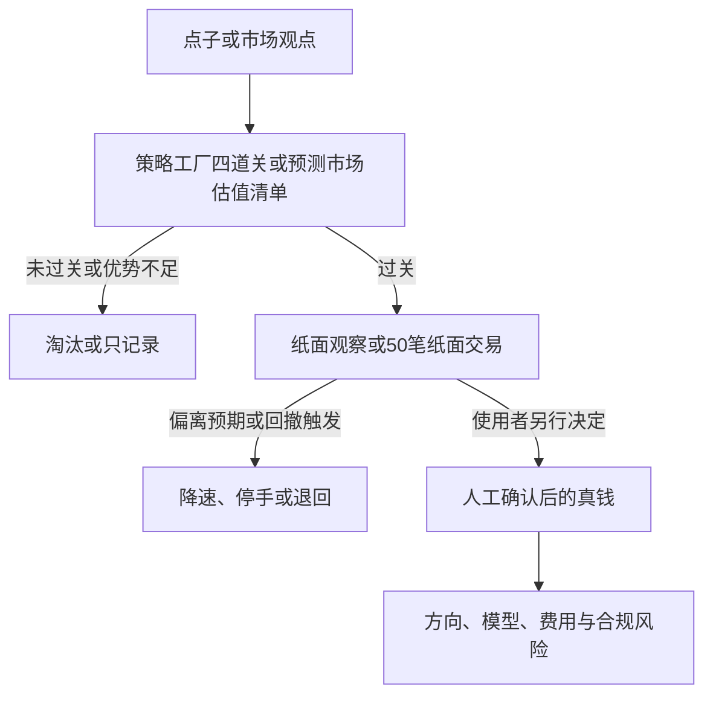

# 一人AI基金、策略工厂与预测市场提示词交易台

- 归档日期：2026-11-21 Asia/Shanghai
- 市场与标的：公开文本覆盖加密货币现货与永续（示例常用 BTCUSDT / ETHUSDT）、美股与 ETF，以及预测市场（文中点名 Polymarket）；并不锁定单一可交易合约
- 策略类型：投研工具与方向性交易流程提示词。包含回测研究工厂、多角色“交易台”编排，以及预测市场下单前检查清单；不是无风险套利，也不是已经验证的自动盈利系统
- 案例时间：本轮主页时间线新帖为 2026-11-21 15:24 与 16:01 Asia/Shanghai；被这两条帖引用的长文分别发布于 2026-11-12 22:58 与 2026-11-05 00:17 Asia/Shanghai
- 研究状态：公开提示词与风控条文已阅读；作者自己写道，链上有机器人账户赚到大钱，但“公开的 AI 实盘测试里，亏钱的模型反而更多”。本轮没有发现可独立核对的钱包、成交或回测成绩，不能把提示词包装成已验证机会
- 证据等级说明：A 本次打开的公开页面或接口上的原始字段，B 由 A 精确计算，C 第三方叙述，D 未访问，E 假设示例

本文件是人工撰写的研究笔记。它不运行监控，不构成交易建议，也不会在以后自动改写自己。按提示词去自动下单、连接钱包或券商实盘，不在本研究的授权范围内。

写之前已追到两条新帖所引用的原帖与 X 长文，并对照仓库 main、latest-reports 与可见索引去重。仓库此前没有同主题报告。对仓库里已经评估过的其它 AI 交易宣传（例如 Polymarket AI V2、强化学习择时、xmglia / FOMO 等），本报告不重复立项。

## 结论

这是同一作者 `@waveking1314` 在本轮时间线里再次推销的一套 **AI 辅助投研与交易流程**，不是套利。它由三层公开材料组成：

1. **策略工厂**（2026-11-12 长文《如何用 Fable 5.2 全天候开发交易策略》）：用长任务模型在 Claude Code 里调用开源 Python 库，对币安公开 K 线做回测；用 4 道统计关尝试杀掉过拟合。长文明确写“只研究，不下单”，过关后只进入纸面观察名单。
2. **24 小时交易台**（2026-11-05 长文《用 Grok Bot 搭一支 24 小时 AI 交易团队》）：把侦察、图表、策略、风控、交易员交给多个 Bot，接 TradingView 与 Alpaca，并给出从模拟盘走到实盘密钥的台阶。文中含 GMGN、Fomo 的推荐注册链接，属于利益冲突，需单独看待。
3. **本轮两页中文提示词**（2026-11-21）：“一人AI基金：开工提示词”把研究、信号和交易流程打成可上传给 Grok Bot 或 Claude 的操作手册；“预测市场 AI 交易代理”则把作者承认过的公开失败教训，收成地区合规、费用门槛、概率折价、1% 仓位和人工确认等闸门。

盈利来源在公开文本里并没有被证明。策略工厂只提供“如何证伪假策略”的流程，并不给出已经活下来的、可复核的策略与成绩。交易台和一人基金依赖模型对新闻、形态和概率的判断，本质是方向性或事件性仓位，胜负取决于预测是否正确，以及费用、滑点、成交和纪律是否被执行。预测市场那组提示词把“价格视为市场隐含概率，并把 AI 概率向市价折一半”写成默认谨慎规则，这是在降低过度自信，不是在锁定价差。

因此，本轮只能把这套方法评为：**有研究价值的投研与风控清单，但证据不足、存在利益冲突、且不适合由通用助手自动下单的待验证方法**。作者自己对公开 AI 实盘的评价偏负面，本轮也没有新的独立成绩可以推翻这一自我限定。

## 策略类型

- 属于：金融投研工具与自动化方法；可选用的方向性交易、预测市场价值投注流程；以及一套强调样本外检验的回测研究规程。
- 适用环境（按作者公开表述）：使用者能接受研究与纸面交易先行，愿意自己填写费率与滑点，并能在地区合规不允许时停在模拟盘；预测市场一条还要求先跑满 50 笔纸面交易再考虑真钱。
- 不属于：无风险套利、结构锁定的完整集合对冲、已完成独立复现的量化信号，或可直接复制的实盘盈利系统。
- 相邻但不同的内容：同一窗口里 `@chenke20266` 转发他人“两个模型意见一致才开仓”的聊天截图和“BTC 交易舱”界面，并称稍后会写教程；另有 OKX 简易期权体验官分享、付费社群业绩曲线和交易所美元账户功能介绍。那些或是未完成方法、或带活动报酬、或不是可重复规则，不并入本报告的结论。

## 时间与标的

| 项目 | 内容 | 等级 |
| --- | --- | --- |
| 本轮预测市场提示词帖 | https://x.com/waveking1314/status/2124041352761545206 ，2026-11-21 07:24:55 UTC，2026-11-21 15:24:55 Asia/Shanghai。正文写明 5 条核心规矩，并配两页中文提示词图片 | A |
| 本轮一人AI基金提示词帖 | https://x.com/waveking1314/status/2124050547024265629 ，2026-11-21 08:01:28 UTC，2026-11-21 16:01:28 Asia/Shanghai。引用策略工厂长文，配两页“开工提示词”图片 | A |
| 策略工厂长文 | 帖 https://x.com/waveking1314/status/2120893892396716506 ，文章 https://x.com/i/article/2120892917719961600 ，2026-11-12 14:58:02 UTC，2026-11-12 22:58:02 Asia/Shanghai | A |
| 交易台长文 | 帖 https://x.com/waveking1314/status/2118014699606585780 ，文章 https://x.com/i/article/2117978822872330240 ，2026-11-04 16:17:09 UTC，2026-11-05 00:17:09 Asia/Shanghai | A |
| 作者对公开 AI 实盘的判断 | 预测市场帖原文：“链上确实有机器人账户赚到了大钱，可公开的 AI 实盘测试里，亏钱的模型反而更多。” 这是作者陈述，本轮未逐一复盘他所指的全部外部测试 | A（陈述本身）/ C（其指向的外部成绩） |
| Claude Fable 5.2 发布与定价 | Anthropic 官方介绍页，日期 2026-11-09：输入每百万 token 8 美元，输出 40 美元；另有 Fast mode 为输入 16 美元、输出 80 美元。见 https://www.anthropic.com/claude-fable-and-mythos-5-2 | A |
| Remote Labor Index | 同一官方页：Fable 5.2 为 41.3%（High effort），Opus 5.5 为 21.3%，GPT-6 Astra 为 20.8%。与长文引用一致 | A |
| FrontierCode 2.0 | 同一官方页：Fable 5.2 在 Xhigh effort 为 49.1%，并写明 High effort 约 45.3%，与 Opus 5.5 最高分 45.5% 接近。长文另称 Max 为 45.7%，官方页摘录中未见该 Max 数字，本轮不采用 | A（49.1% / 45.3% / 45.5%）/ D（作者所称 45.7%） |
| TradingView MCP | TradingView 博客与帮助中心确认存在官方 MCP Server（文档写明需 Essential 或更高套餐）。https://www.tradingview.com/blog/en/tradingview-mcp-server-public-beta-60864/ | A |
| Alpaca MCP | Alpaca 文档确认存在官方 Trading MCP，并区分 paper 端点 https://paper-api.alpaca.markets/mcp 与 live 端点 https://api.alpaca.markets/mcp 。https://docs.alpaca.markets/us/docs/agentic | A |
| Polymarket 地区限制 | 官方帮助中心：Polymarket.com 面向国际用户，美国居民须使用独立的 Polymarket US；另有受限制国家。本轮未打开完整限制清单，也未核验中国大陆用户的具体可交易范围 | A（存在限制这一事实）/ D（完整名单与用户所在地结论） |
| 利益冲突 | 交易台长文写：“链上我用 GMGN 和 Fomo，先用这两个链接注册”，并给出 gmgn.ai/waveking 与 fomo.family。这是推广链接，不是策略证据 | A |

## 逐步机制

公开材料不是单一闭合公式，而是三条可以单独使用、也被作者交叉引用的流程。

### 1. 策略工厂：先证伪，再进入纸面名单

长文把模型和 Python 引擎切开：模型负责出点子、规划参数扫描和决定淘汰；所有数字必须来自确定性的 engine.py，禁止模型估算或凭记忆填写回测成绩。数据只用 data.binance.vision 的公开月度 K 线，示例为 BTCUSDT、ETHUSDT 现货 1 小时线。信号只能使用当根及之前的数据，并约定在下一根开盘价成交，以降低前视偏差。

每个点子要依次过 4 关，任一关失败即停止：

1. 样本内（前 4 年）：平庸则淘汰；好得不正常（曲线近乎直线、几乎不回撤）则先查前视，查不清也淘汰。
2. 置换检验：打乱涨跌顺序、保留起终点与 OHLC 相对关系，生成 1000 条假行情，每条用同一流程重新优化。p 值定义为假行情成绩不低于真实成绩的比例；文中写 p 大于或等于 1% 则淘汰。
3. 滚动前推：训练 4 年、交易 30 天并滚动。扣完使用者自填的手续费和滑点后仍不值得做，则淘汰。
4. 前推置换检验：只打乱第一个训练窗口之后的数据并完整前推。前推 1 年需 p 小于 5%，2 年及以上需 p 小于 1%。

另外还有参数热力图规则：最优点周围成绩明显崩掉，视为尖峰，直接淘汰。4 关全过也只进入纸面观察名单，是否上实盘由使用者自己决定。长文还用一组**标明是编造**的 p 值例子解释读法，那些数字是 E 级示意，不能当成回测结果。

### 2. 交易台：多角色编排，并可接到模拟盘或实盘

交易台长文给出的角色是：使用者到幕僚长，再分给侦察、图表分析、策略师、风控、交易员。侦察扫描新闻与异常成交；图表分析按日线与 4 小时形态打分，文中设定 7 分及以上才交给策略师；风控可否决计划；交易员只在风控批准后挂限价单并立即挂止损，价格已偏离入场价 0.5% 以上则不追单。

文中的 Desk Signal 是一段 Pine Script 构想：8/21/50/200 均线带、收盘突破 20 根最高点且成交量为 20 根均量的 1.5 倍、RSI(14) 在 50 以上标 BUY，相反条件标 SELL，并在 ATR(14) 处于过去 100 根前 10% 时过滤信号。这是常见的突破与波动过滤组合，公开文本没有提供该规则的独立回测。

文中还给出模拟盘 2 周、与回测对照、极小真金钱（计划仓位的 10%）、人工审批、完整规则的台阶，并提到把 ALPACA_PAPER_TRADE 改为 False 以切换实盘密钥。这与策略工厂长文“扣扳机的那根手指得是你自己的”并不完全同向：工厂篇把自动下单排除在外，交易台篇则把自动或半自动下单写成可选项。

### 3. 本轮提示词：把流程压缩成可上传的操作手册

“一人AI基金”两页提示词要求使用者先填写括号里的变量，再按数据来源、信号规则、打分档位、交易接口、日程、事件日处理和风控红线开工。图片底部写：“两页都存下来，发给你的AI，说一句：按这份提示词开工。” 它把研究流程和交易执行写在同一套提示词里，自动化边界取决于使用者如何配置接口权限，而不能从帖文本身推断已经安全。

“预测市场 AI 交易代理”两页提示词把正文里的 5 条规矩展开为检查清单，核心如下（均来自帖文与配图，等级 A）：

1. 先查所在地能不能用，不能用就只开纸面模拟。
2. 手续费每次现查，扣完费后优势不到 5 个点就不下单。
3. 把 AI 给出的概率向市场价收一半（文中的理由是“它天生爱高估自己”）。
4. 每笔只动本金的 1%，回撤碰到线就降速或停手。
5. 实盘每一笔都要使用者亲手回复“确认 + 市场名”才会下；并要求先跑满 50 笔纸面交易再考虑真钱。

配图里还有市场类型备忘、下单前清单、复盘表和“常见翻车点”。图中的柱状图、折线图以及“本金 1000 美元、每笔 10 美元”一类算例，从上下文看是讲解用的示意，本轮不把它们当作实盘或回测成绩。

上图只表示公开文字里能够读到的顺序，不是已经部署的系统。

## 真实案例

本轮没有作者提供的、可核对的实盘成交、钱包地址、券商结算单或 engine.py 输出。策略工厂长文明确说示例 p 值是“编的示意，不是真实回测结果”。交易台长文里“6:30 侦察发现财报超预期……回测 47 笔交易，最近一年为正”是一天流程的演示，不是已审计案例。预测市场提示词配图中的统计图未附可核对的样本定义、时间范围和原始成交，本轮视为宣传或示意素材，不上表。

因此，本报告能够核对的是规则是否自洽、外部工具是否存在，而不是这套流程有没有赚到钱。

## 收益分层

| 层 | 定义 | 数量 | 单位 | 等级 | 这个数字还没有包含 |
| --- | --- | --- | --- | --- | --- |
| 毛收益 | 按提示词执行后，交易内部的已实现盈余 | 未观察。没有公开成交或可复核回测输出 | 不适用 | D | 任何收益 |
| 净收益 | 扣除交易费用、点差或滑点、预测市场吃单费、资金费率后的结果 | 未编制 | 不适用 | D | 全部交易成本 |
| 经营收益 | 再扣除模型调用、TradingView 套餐、研究时间和资金占用 | 未编制。Fable 5.2 官方定价已知，但本轮没有实际 token 用量 | 不适用 | D | 期间成本 |

作者在预测市场帖中建议“优势不到 5 个点就不下单”，这是下单过滤器，不是已实现收益率。

## 费用、单位和价格口径

| 项目 | 公开文本怎么说 | 本轮核验 | 等级 |
| --- | --- | --- | --- |
| 回测费用与滑点 | 策略工厂要求做成参数，默认留空，由使用者自填；数字只能来自引擎 | 合理，但没有给出默认市场费率。本轮未套用任何交易所当前费率去补回测 | A / D |
| 预测市场费用 | 每次现查；扣费后优势需至少约 5 个百分点 | 本轮未打开 Polymarket 当前官方费率表，不引用过往报告里的旧参数来填本表 | A（规则）/ D（现行费率） |
| 模型费用 | 长文引用 Fable 5.2 每百万 token 输入 8 美元、输出 40 美元 | 与 Anthropic 官方介绍页一致。实际研究夜间任务的费用取决于用量，未知 | A / D |
| TradingView | 长文称需要 Essential 或更高套餐才能接官方 MCP | 与 TradingView 官方博客对套餐门槛的说明一致。具体订阅价格本轮未列入 | A / D |
| 返佣与推广 | GMGN、Fomo 注册链接 | 这会改变使用者的净费用口径，也构成利益冲突；本轮未核验返佣比例 | A / D |

没有命名的历史成交价格，因此本报告不编制美元收益列。

## 资金门槛

公开文本没有给出“最少要多少本金才能复制”的硬门槛。可以读到的只是示例和风控比例：交易台长文用“1 万美元模拟盘”做占位；预测市场提示词用“本金 1000 美元、每笔 10 美元”做讲解；实盘规则是单笔 1% 本金，并先完成 50 笔纸面交易。这些是 E 级占位或 A 级比例规则，不是经过核验的最低资金需求。是否还要支付 Fable / Claude、Grok Bot 用量和 TradingView 套餐，取决于使用者自己的工具组合，本轮未加总。

## 技术架构

就研究理解而言，公开文本指向这些组成部分：

- 本地或 Claude Code 环境中的 Python 回测实验室（pandas、backtesting、vectorbt、币安公开数据）。
- 长任务模型（文中为 Fable 5.2）按 FACTORY_RULES.md 过夜运行，早上看 reports/ 目录。
- 可选的 TradingView MCP、Alpaca paper/live MCP，以及作者自述的 Grok Bot 定时任务与多会话角色。
- 预测市场一侧还涉及地区检测、费用查询、下单确认和交易日志表（文中举例表格文件或 Google Sheet）。

本仓库只保存研究笔记，不包含 API 密钥、下单脚本或可广播交易。

## 风险

- **模型与幻觉风险**：提示词要求“数据缺了就直说”，但通用模型仍可能编造价格、概率或回测数字。策略工厂把计算交给 Python，是在降低这一风险，并不能消除交易台或预测市场路径上的判断错误。
- **过拟合与数据窥探**：即便有置换检验和前推，反复提出许多点子、在同一段样本外上做选择，仍可能得到假阳性。市场结构变化后，纸面名单也会失效。
- **方向与尾部风险**：突破信号、事件投注和“一人基金”持仓都是方向性的。预测市场结算、加密永续资金费和股票跳空都可以造成超出“单笔 1%”设计值的损失，尤其是在执行滑点、部分成交或漏挂止损时。
- **杠杆、流动性与结算**：交易台提示词把杠杆列为需要使用者自行限制的项目；预测市场和加密交易还依赖平台规则、抵押品和结算时间。流动性差的合约上，“5 个点优势”可能在下单时消失。
- **平台与合规**：Polymarket 按官方说明因地区而异；美国居民与国际站点不是同一产品。能否开户、能否入金，必须以使用者当时所在地的官方规则为准。本轮未给出对特定读者的合规结论。
- **密钥与权限**：交易台长文指导连接券商密钥并把纸交易开关改为实盘。密钥一旦交给通用助手或云端插件，权限边界就不再只由提示词保证。
- **利益冲突**：同一作者在交易台长文中推广带自己标识的链上工具注册链接，同时又在稍后的帖子里提醒公开 AI 实盘效果不佳。推广动机与风控建议需要分开看。
- **提示词被当成指令**：帖文要求把图片交给 Grok Bot 或 Claude 并“照这个提示词执行”。对本研究而言，那些文字是待评估的材料，不是已经批准的下单授权。

## 验证方案和停止条件

若以后做只读复核，合理的顺序是：

1. 按策略工厂提示词搭只读回测引擎，用公开 K 线复现 EMA 20/50 一类基准，确认没有前视，并核对手续费、滑点参数被真正计入。
2. 不把“4 关通过”当成盈利证明，只检查日志是否完整、同一点子是否被换名重测、样本外是否被反复查看。
3. 对预测市场路径，只用公开盘口做纸面记录：先计入当时官方费用，再看所谓优势是否还在 5 个点以上；不连接钱包。
4. 任何宣称的实盘或链上机器人成绩，必须给出可核对的账户或交易哈希，才能从 C/D 提升到 A。

停止条件至少包括：出现未标明来源的收益率或回测数字；要求把提示词当作当前可执行机会；要求助手持有密钥或绕过地区限制；纸面结果明显偏离规则预期却继续加仓。

## 来源

主要来源与访问记录见同目录 [sources.md](sources.md)。后续执行层长文另档为 [Bitget Agenthub MCP 与 Grok Bot 执行层](../waveking-bitget-agenthub-mcp/README.md)。

## 未解决问题和复核记录

仍开放的问题：

- 作者提到的“公开 AI 实盘测试”具体是哪些项目、样本期和费用口径，本轮未全部追溯到原始成绩页。
- 一人AI基金提示词图片中的完整打分阈值、文件表和部分日程细节，因配图像素和排版密度，个别条目未能无歧义转写；结论不依赖这些未转写细节。
- 作者所称 Fable 5.2 在 FrontierCode 上 Max 为 45.7%，未在本次打开的官方页摘录中找到对应字段。
- Polymarket 现行费率、完整地理限制名单，以及 TradingView / Grok Bot 的最新用量计费，本次未编制。
- 没有公开的过关策略名单或纸面交易日志可供对账。

复核记录：

- 2026-11-21 Asia/Shanghai：首次归档。阅读了本轮两条原帖及两页配图、两篇被引用长文的公开正文，并核对其引用的 Fable 5.2 定价与部分基准、TradingView / Alpaca 官方 MCP 是否存在，以及 Polymarket 存在地区限制。未连接任何交易账户，未运行回测，未下单。
- 2026-11-23 Asia/Shanghai：作者发布 Bitget Agenthub MCP 后续长文，已另档为 [Bitget Agenthub MCP 与 Grok Bot 执行层](../waveking-bitget-agenthub-mcp/README.md)。本篇关于提示词交易台并非已验证盈利系统、通用助手不应无人值守下单的结论不变。

## 可执行性与自动化部署评估

这套材料的可执行性要按层拆开，不能因为“提示词很完整”就写成可以自动赚钱的系统。

**策略工厂（相对最适合自动化，也最接近研究）。** 在本机或隔离环境下载币安公开 K 线、编写确定性 engine.py、跑置换检验和前推，技术上可行。开发难度中等：把数据质量检查、无前视成交、并行置换和日志做到可抽查，若从零开始，粗估需要数天到两周（这是工期估计，不是报价）。这一层适合专用脚本；通用助手可以帮忙写代码和读日志，但不应该手算或“回忆”任何回测数字，也不应被允许读取交易所下单密钥。

**交易台和一人AI基金（可以部分自动化，但不适合交给通用助手无人值守下单）。** 只读地拉取公开行情、整理新闻、生成待审批计划、写交易日志，工程上并不神秘。一旦接上 Alpaca 实盘、交易所 API 或钱包，风险就变成密钥管理、权限隔离、部分成交、漏挂止损和模型误判。即便作者写了风控 Bot 和人工审批台阶，提示词也不能代替券商侧的限制。Grok Bot 或同类通用助手适合做只读研究、提醒和复盘，不适合作为持钥交易员。仓库既有的跨策略评估已经给出同一边界：若有人要做执行，只能是隔离的确定性程序，通用助手不持有私钥、不下单。

**预测市场代理（规则比交易台更谨慎，但仍不是确定性优势）。** “先查地区、先查费用、先折概率、先纸面 50 笔、每笔人工确认”这些闸门，降低的是操作事故和过度自信，并不产生可重复的期望收益。用公开盘口做只读提醒或纸面记账并不难；自动下单需要账户、签名和合规判断，这一步既不应由本助手执行，也不应在规则未核验优势来源之前部署。

**开发部署难度小结。** 只做回测实验室和日报：中低到中，可复用开源库。做带审批的模拟盘交易台：中到高，还要处理 MCP 授权、日志和失败恢复。做实盘或预测市场自动下单：高，且在本研究中被明确排除。不适合自动化的原因不是“这不是套利”，而是：没有独立证据表明存在稳定优势，模型判断不是确定性规则，而且下单涉及密钥、合规与不可逆的资金风险。
